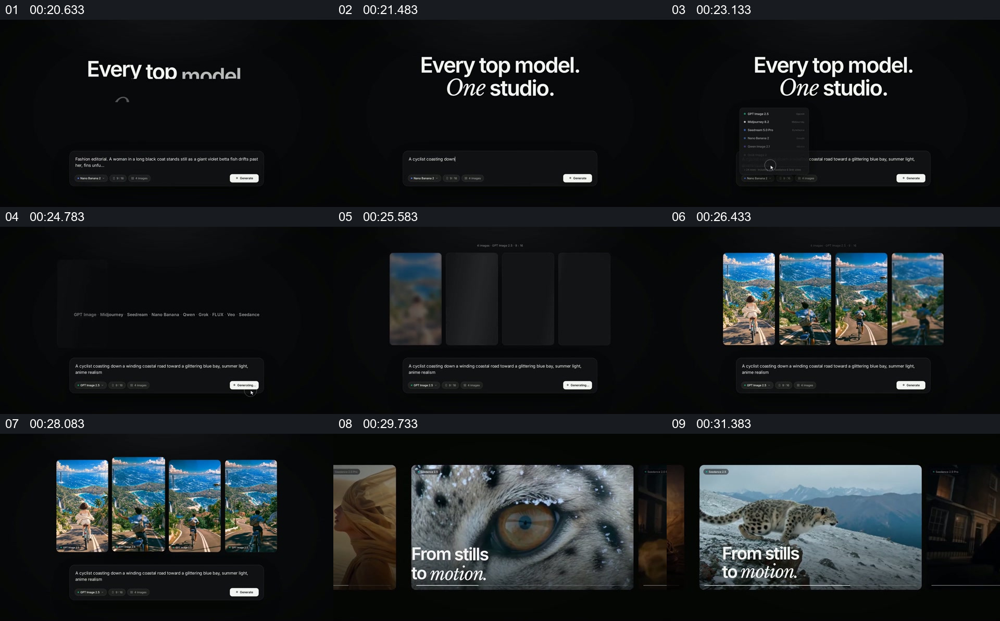

# 让输入与多个并列结果同处一屏，再展示结果的不同状态

- 作品：案例 136（原批次 A03）《GenVizu图片墙与界面接力》；[公开来源](https://www.reclip.io/claude-opus-5-5-video-prompts/genvizu-product-launch)。
- 原片范围：00:20.000—00:32.700，源时间，含起点、不含终点；[本地来源视频](../video.mp4)｜[本卡片段](c02.mp4)。
- 范围依据：从单个输入界面到多个候选同屏，再转到图像前后状态示例；随后开始新的代理工作区。
- 观察方式与未确认范围：本轮查看整段来源的 64 帧时间序列及本卡九格，未独立完成连续原速观看；抽帧之间的连续运动、交叠、速度和停顿均待复核。本地视频有音轨，但本轮未完成听审。作品分析不等同于作者意图；迁移方法尚未在新项目实做。
- 原批次编号：A03-c02；正式编号：136-c02。

## 原画面具体怎样设计

黑色背景中央出现一句主标题，下方是细长的输入区域和模型选项。随后上方出现四个竖向画面槽位，几张内容相似的风景图片先后填入，输入栏仍保留在下方。

后续画面切到横向图片集合，雪豹眼睛的特写位于中央并叠有“From stills to motion.”；之后中央画面变为雪豹在山地中的全身画面。静帧不足以确认其是否为同一张静帧实际生成的视频。

## 为什么这样设计，好在哪里

作品分析：输入和多个结果同屏，观众可直接比较不同候选而不丢失条件；眼部特写与较远画面又提供不同观察距离。两种图片能否证明生成或动作关系，需要查看原片和真实素材，不能从广告描述推断。

## 完整照排指令

以[完整原片](../video.mp4)的 20–32.7 秒为准。画幅 1920×1080，源帧率 60/1。以下拍点为抽帧定位，位置按画幅百分比取近似值。

### 源时刻照排

- 20–约 25 秒，纯黑底居中两行白色【模型标题】，第二行用衬线斜体。下方放宽而低的暗灰【输入栏】，小号【输入原文】左齐，白色提交控件在右端；【模型选项】从输入栏附近展开。
- 约 25–29 秒，标题淡出，在输入栏上方并排建立四等宽竖槽，逐次填入【四联输出】，保留各画幅相同的天空与地景辨识点。输入栏原位留存至整组退出。
- 约 29–32.7 秒，宽横卡接管，周边只露邻卡的暗色边缘，中央先是【眼部特写】，左下白色【动静标题】用正体与斜体分两行；随后同位置换【山地全身画面】，标题持续，结束于动物动作尚可见时。

### 用料与取用

【模型标题】【输入栏】【输入原文】【模型选项】与【四联输出】应对应同一测试提示及四种确有记录的结果，须提供各模型版本和可核对生成记录，演示样例注明。输入栏自 20 秒持续到约 29 秒并允许静态 UI 分层；四联若为动态图，每窗从填入持续到约 29 秒，供足长素材，不用循环或停帧伪造生成。【眼部特写】【山地全身画面】要有同一动物的可辨特征或明确说明只是同题材，若宣称由图生成视频，须提供该静帧与真实产出记录。前者可用静图，后者备足一次动作，禁止循环或照片运镜替代奔跃。【动静标题】须与实际材料一致。只具备模型对照可用 20–29 秒；只有动物动静对照可取约 29–32.7 秒。

### 验证状态

已对照原片密集抽帧与卡稿，核对输入栏持续、四槽填充和动物画面接管。生成因果、动作精确帧、原速听看及试摆待核。
