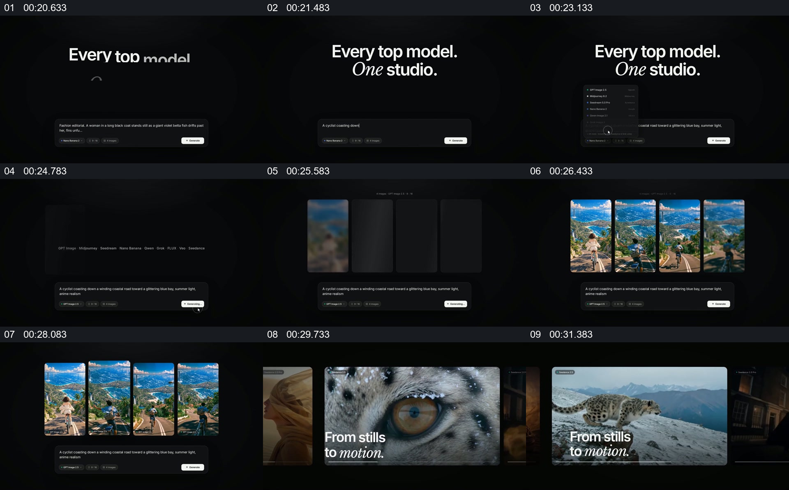

# 让输入与多个并列结果同处一屏，再展示结果的不同状态

- 作品：案例 136（原批次 A03）《GenVizu图片墙与界面接力》；[公开来源](https://www.reclip.io/claude-opus-5-5-video-prompts/genvizu-product-launch)。
- 原片范围：00:20.000—00:32.700，源时间，含起点、不含终点；[本地来源视频](../video.mp4)｜[本卡片段](c02.mp4)。
- 范围依据：从单个输入界面到多个候选同屏，再转到图像前后状态示例；随后开始新的代理工作区。
- 观察方式与未确认范围：本轮查看整段来源的 64 帧时间序列及本卡九格，未独立完成连续原速观看；抽帧之间的连续运动、交叠、速度和停顿均待复核。本地视频有音轨，但本轮未完成听审。作品分析不等同于作者意图；迁移方法尚未在新项目实做。
- 原批次编号：A03-c02；正式编号：136-c02。

## 原画面具体怎样设计

黑色背景中央出现一句主标题，下方是细长的输入区域和模型选项。随后上方出现四个竖向画面槽位，几张内容相似的风景图片先后填入，输入栏仍保留在下方。

后续画面切到横向图片集合，雪豹眼睛的特写位于中央并叠有“From stills to motion.”；之后中央画面变为雪豹在山地中的全身画面。静帧不足以确认其是否为同一张静帧实际生成的视频。

## 为什么这样设计，好在哪里

作品分析：输入和多个结果同屏，观众可直接比较不同候选而不丢失条件；眼部特写与较远画面又提供不同观察距离。两种图片能否证明生成或动作关系，需要查看原片和真实素材，不能从广告描述推断。

## 可直接使用的创意指令

若要比较多个结果，固定可核实的共同输入或条件，让多份结果并列并留出各自边界；保留输入说明，便于判断比较基础。若进一步展示结果的不同状态，确保前后素材确有对应关系，并让细节与整体都能辨认。页面、模型数量和题材可变；没有真实处理证据时应标明是视觉演示。
