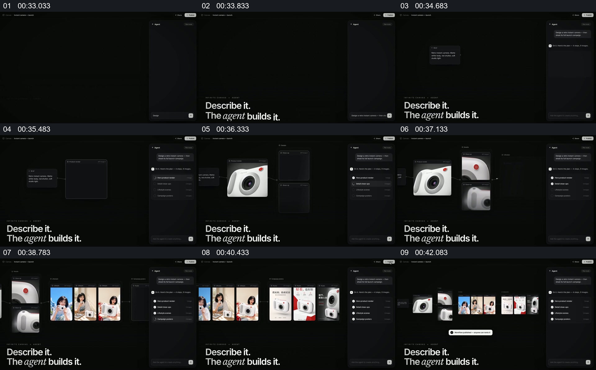

# 在工作区中让单个素材发展成一组输出

- 作品：案例 136（原批次 A03）《GenVizu图片墙与界面接力》；[公开来源](https://www.reclip.io/claude-opus-5-5-video-prompts/genvizu-product-launch)。
- 原片范围：00:33.000—00:43.000，源时间，含起点、不含终点；[本地来源视频](../video.mp4)｜[本卡片段](c03.mp4)。
- 范围依据：从空白工作区及请求，到产品素材和多张结果在同一界面展开；43 秒后转入不同作品分类。
- 观察方式与未确认范围：本轮查看整段来源的 64 帧时间序列及本卡九格，未独立完成连续原速观看；抽帧之间的连续运动、交叠、速度和停顿均待复核。本地视频有音轨，但本轮未完成听审。作品分析不等同于作者意图；迁移方法尚未在新项目实做。
- 原批次编号：A03-c03；正式编号：136-c03。

## 原画面具体怎样设计

深色工作区的右侧保留类似聊天和操作记录的窄栏，左侧有说明句；中央起初较空，之后出现一个带图片的方块。后续抽帧中，产品特写、人物图片与版式示例逐步出现在中央画布上，排列成横向的一组输出。

右侧文字栏贯穿多个阶段，中央从单个产品素材扩展为多张不同构图的结果；作品没有提供足以核验真实操作过程的证据。

## 为什么这样设计，好在哪里

作品分析：固定侧栏给画面变化提供过程参照，而中央增加的素材与结果让观众看到工作空间由空到满；多张结果同时保留，能直接比较其构图差异。画面中的生成过程和工具能力应视为演示。

## 可直接使用的创意指令

用可核对的素材和步骤展示一个工作过程：保留可识别的请求或步骤区，在主要画布中先放输入，再依次呈现与之相关的结果，并最终让多份输出同屏可比较。界面样式和结果数量可改；保留输入、操作依据和结果的对应，不把广告动画当作实际操作录屏。
