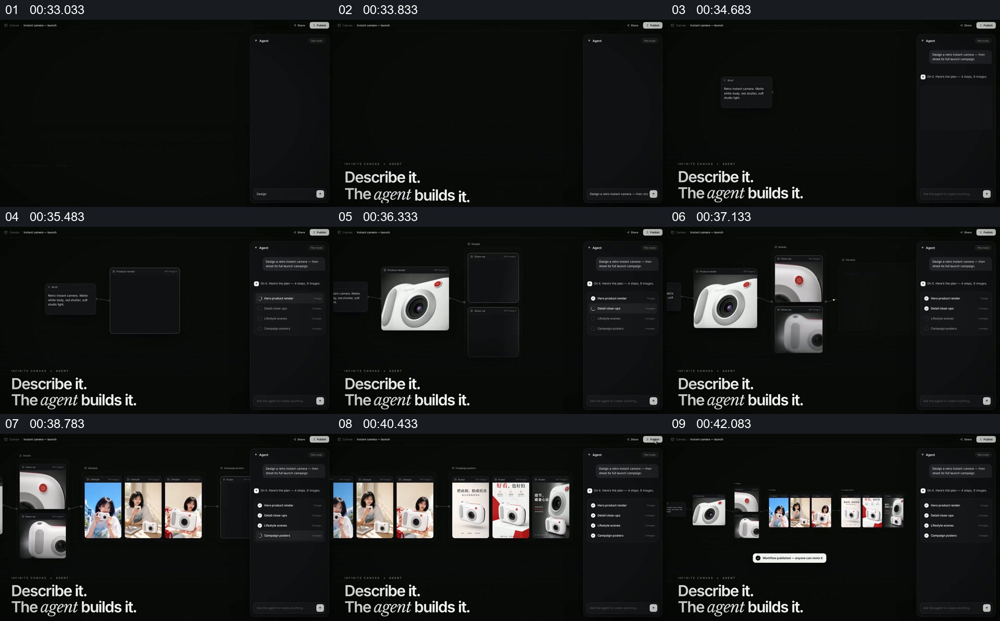

# 在工作区中让单个素材发展成一组输出

- 作品：案例 136（原批次 A03）《GenVizu图片墙与界面接力》；[公开来源](https://www.reclip.io/claude-opus-5-5-video-prompts/genvizu-product-launch)。
- 原片范围：00:33.000—00:43.000，源时间，含起点、不含终点；[本地来源视频](../video.mp4)｜[本卡片段](c03.mp4)。
- 范围依据：从空白工作区及请求，到产品素材和多张结果在同一界面展开；43 秒后转入不同作品分类。
- 观察方式与未确认范围：本轮查看整段来源的 64 帧时间序列及本卡九格，未独立完成连续原速观看；抽帧之间的连续运动、交叠、速度和停顿均待复核。本地视频有音轨，但本轮未完成听审。作品分析不等同于作者意图；迁移方法尚未在新项目实做。
- 原批次编号：A03-c03；正式编号：136-c03。

## 原画面具体怎样设计

深色工作区的右侧保留类似聊天和操作记录的窄栏，左侧有说明句；中央起初较空，之后出现一个带图片的方块。后续抽帧中，产品特写、人物图片与版式示例逐步出现在中央画布上，排列成横向的一组输出。

右侧文字栏贯穿多个阶段，中央从单个产品素材扩展为多张不同构图的结果；作品没有提供足以核验真实操作过程的证据。

## 为什么这样设计，好在哪里

作品分析：固定侧栏给画面变化提供过程参照，而中央增加的素材与结果让观众看到工作空间由空到满；多张结果同时保留，能直接比较其构图差异。画面中的生成过程和工具能力应视为演示。

## 完整照排指令

以[完整原片](../video.mp4)的 33–43 秒为准。画幅 1920×1080，源帧率 60/1。以下拍点为抽帧定位，位置按画幅百分比取近似值。

### 源时刻照排

- 33–约 36 秒，深色【工作区】中央初留空，画右窄【操作栏】以低亮小字逐项更新，左下叠白色两行【说明短句】，次行用斜体。中央先放独立正方形【产品原图】。
- 约 36–41 秒，产品主体图留在画布左侧，向右依次出现【产品细节】【人物样例】【版式样例】。卡片与空槽分层，图像填好后不撤，右栏记录随相应卡片补齐。
- 约 41–43 秒，拉远或缩小横排以见全套，底下出现短白胶囊【结果控件】，左下文案和右栏保持原锚点，切出前画布结果仍可辨。

### 用料与取用

【产品原图】【产品细节】【人物样例】【版式样例】须能对应一次真实任务及同一产品，供产品细节、人物授权图和可辨画布布局，初张自约 35 秒起留至 43 秒，各输出从落位保持到切出。静态图可以卡片分层移动，动态结果需供足长且不循环或定格。【工作区】【操作栏】【结果控件】交同一实际项目状态或标明演示，真实操作附版本、原始请求和任务记录；【说明短句】贴合证据。只具单产品及一张结果可取约 35–37 秒，最后结果可辨即切，省去全套主张。

### 验证状态

已对照原片密集抽帧与卡稿，核查固定右栏、同产品素材留存和横向输出逐步建立。真实操作、精确切点、原速听看与试摆待核。
