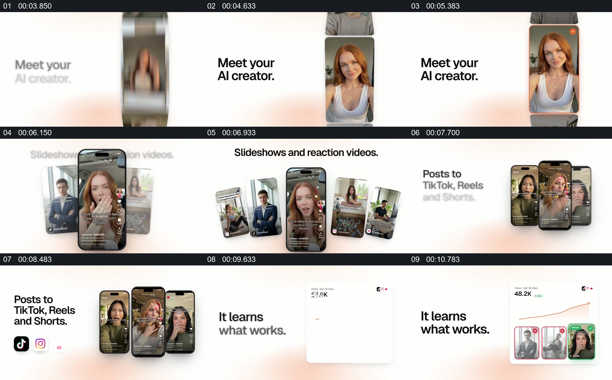

# 让一个人物扩展成多屏内容，再连接发布与反馈

- 作品：案例 137（原批次 A04）《ViralGrow人物素材与多屏组合》；[公开来源](https://www.reclip.io/claude-opus-5-5-video-prompts/viralgrow-product-promo)。
- 原片范围：00:03.450—00:11.200，源时间，含起点、不含终点；[本地来源视频](../video.mp4)｜[本卡片段](c01.mp4)。
- 范围依据：从单个人物选择到多部手机并列、平台标识与反馈卡；随后切换到新的图片墙和品牌收尾。
- 观察方式与未确认范围：本轮查看整段来源的 40 帧时间序列及本卡九格，未独立完成连续原速观看；抽帧之间的连续运动、交叠、速度和停顿均待复核。本地视频有音轨，但本轮未完成听审。作品分析不等同于作者意图；迁移方法尚未在新项目实做。
- 原批次编号：A04-c01；正式编号：137-c01。

## 原画面具体怎样设计

浅色背景左侧文字介绍创作者，右侧竖向人物图片显示多个候选；其中红发人物在随后的手机屏幕中出现。旁边逐渐排列其他人物视频窗口，多部倾斜手机形成一组，顶部文字说明内容形式。

接下来屏幕组合收束为三部手机，左侧出现多个平台图标。随后换成白色数据卡，卡片上方是折线和数字，下方排列几位人物的内容缩略图及不同颜色标记。

## 为什么这样设计，好在哪里

作品分析：先建立一个可辨认人物，再让人物出现在具体手机内容中，观众更容易理解素材从角色到输出的关系；多屏与平台图标扩展展示范围，数据卡将注意转向结果。人物、发布行为与统计是否真实均未核验。

## 可直接使用的创意指令

选择授权明确的人物或其他核心主体，先用一份素材建立身份，再展示该主体在几种不同内容版位中的具体呈现。若要说明分发与反馈，分别展示对应渠道和有真实来源的数据，让结果能追溯到实际内容。手机、图标和卡片可替换；保留主体身份及内容、渠道、结果之间的可核对关系。
