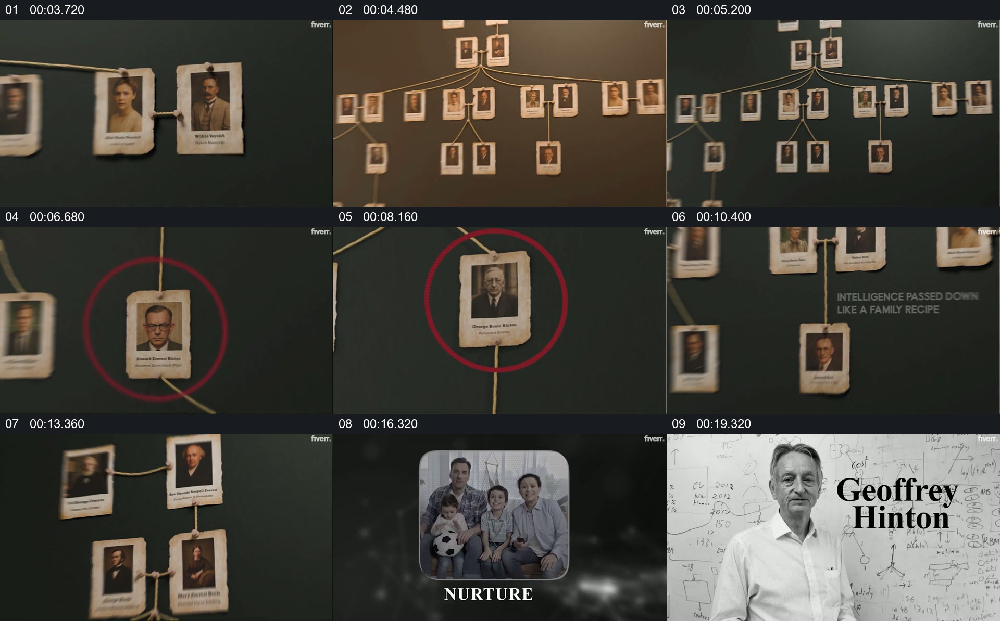

# 从人物关系网找到一个人物，再把他放回具体语境

- 作品：案例 138（原批次 N01）《Hinton人物纪录片样片》；[公开来源](https://www.fiverr.com/yaqub_editor/edit-youtube-documentary-videos-in-vox-style-with-motion-graphics)。
- 原片范围：00:03.000—00:20.700，源时间，含起点、不含终点；[本地来源视频](../video.mp4)｜[本卡片段](c01.mp4)。
- 范围依据：由人物树状图建立，到聚焦不同照片、家庭画面和主体肖像姓名；之后转入新的毕业照文字表达。
- 观察方式与未确认范围：本轮查看整段来源的 64 帧时间序列及本卡九格，未独立完成连续原速观看；抽帧之间的连续运动、交叠、速度和停顿均待复核。本地视频有音轨，但本轮未完成听审。作品分析不等同于作者意图；迁移方法尚未在新项目实做。
- 原批次编号：N01-c01；正式编号：138-c01。

## 原画面具体怎样设计

深绿色背景上，多张带边框的小肖像由细线连接成树状排列；画面中先可见局部照片，随后能看到更大范围的关系网。某些照片被红圈强调，关系线和其他肖像仍留在周围。

之后画面出现 DNA 图像、家庭合照与“NURTURE”文字，接着是一位老者站在写满公式的背景前，姓名 Geoffrey Hinton 位于右侧。树状图、家庭图与主体肖像先后承担关系背景和人物身份。

## 为什么这样设计，好在哪里

作品分析：人物网络先展示关系规模，红圈把注意力集中到一张小肖像；家庭画面和单独肖像再将抽象关系落到人物。画面中的血缘、人物身份和背景均属作品叙述，未逐一核验，不能仅凭连线推断真实关系。

## 完整照排指令

以[完整原片](../video.mp4)的 3–20.7 秒为准。画幅 1280×720，源帧率 25/1。以下拍点为抽帧定位，位置按画幅百分比取近似值。

### 源时刻照排

- 3–约 8 秒，深绿暗底上以浅边纸质【家族肖像卡】和细金色【亲缘线】建立局部，拉远让多代关系可见。红色【强调圈】随后放大罩住单张卡，邻卡与接线仍在背景。
- 约 8–14 秒，沿同一树移动焦点，露出不同支系，在空白处用低亮白色无衬线【关系说明】承接，保住相关肖像的相对位置。转场前短暂掠过失焦照片，视觉焦点随之切换。
- 约 14–20.7 秒，暗景中先后出现【遗传示意】、圆角【家庭合照】与白色衬线【环境标题】。接着浅色公式底铺满，左侧【主角肖像】、右侧两行黑色衬线【主角姓名】形成定版，20.7 秒退出。

### 用料与取用

【家族肖像卡】【亲缘线】【强调圈】【关系说明】交同一可核对谱系、人物身份及肖像出处，实际亲缘关系须有可定位档案，勿凭相貌连接。树从 3 秒持续到约 14 秒，各卡固定在同一节点；可用静态档案照片和单次运镜，禁止循环替代焦点推进。【家庭合照】【主角肖像】【主角姓名】给身份、时间与授权来源，能关联同一人物线，图像主体要适合左置。【遗传示意】【环境标题】若涉及遗传与成长的事实判断，需提供可核对研究或传记原文，保留限定。仅有谱系材料可取约 3–14 秒；只有身份照与姓名可取约 17–20.7 秒。

### 验证状态

已对照原片等距抽帧与卡稿，核查肖像、连接、红圈和主角定版。亲缘细字、精确切点、原速听看和试摆待核。
