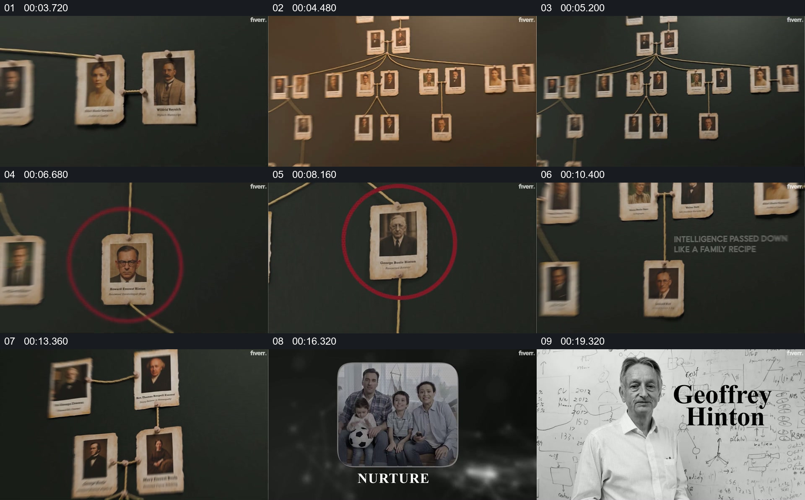

# 从人物关系网找到一个人物，再把他放回具体语境

- 作品：案例 138（原批次 N01）《Hinton人物纪录片样片》；[公开来源](https://www.fiverr.com/yaqub_editor/edit-youtube-documentary-videos-in-vox-style-with-motion-graphics)。
- 原片范围：00:03.000—00:20.700，源时间，含起点、不含终点；[本地来源视频](../video.mp4)｜[本卡片段](c01.mp4)。
- 范围依据：由人物树状图建立，到聚焦不同照片、家庭画面和主体肖像姓名；之后转入新的毕业照文字表达。
- 观察方式与未确认范围：本轮查看整段来源的 64 帧时间序列及本卡九格，未独立完成连续原速观看；抽帧之间的连续运动、交叠、速度和停顿均待复核。本地视频有音轨，但本轮未完成听审。作品分析不等同于作者意图；迁移方法尚未在新项目实做。
- 原批次编号：N01-c01；正式编号：138-c01。

## 原画面具体怎样设计

深绿色背景上，多张带边框的小肖像由细线连接成树状排列；画面中先可见局部照片，随后能看到更大范围的关系网。某些照片被红圈强调，关系线和其他肖像仍留在周围。

之后画面出现 DNA 图像、家庭合照与“NURTURE”文字，接着是一位老者站在写满公式的背景前，姓名 Geoffrey Hinton 位于右侧。树状图、家庭图与主体肖像先后承担关系背景和人物身份。

## 为什么这样设计，好在哪里

作品分析：人物网络先展示关系规模，红圈把注意力集中到一张小肖像；家庭画面和单独肖像再将抽象关系落到人物。画面中的血缘、人物身份和背景均属作品叙述，未逐一核验，不能仅凭连线推断真实关系。

## 可直接使用的创意指令

围绕一个真实人物准备有出处的肖像及已核实关系，先以关系图建立有限范围，再从网络中明确选中需要讲述的对象；保留其他节点或连接作为上下文。随后切到该人物可辨认的影像及姓名，必要时加入有根据的生活或工作材料。树状布局、圈线与背景可替换；只有证据支持的关系才可以连线或命名。
