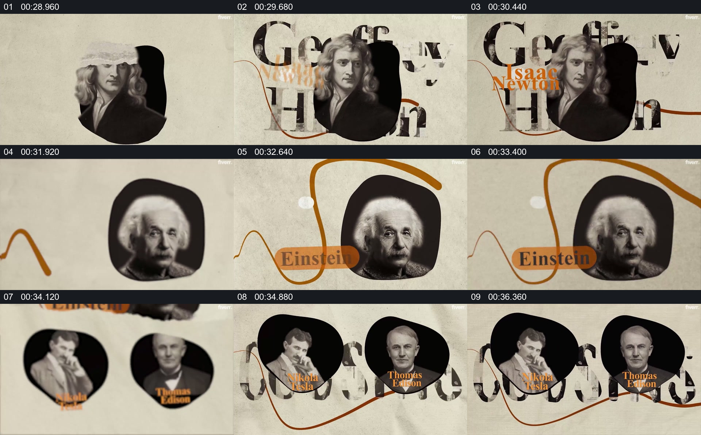

# 用不同人物肖像与一条贯穿线建立并列认识

- 作品：案例 138（原批次 N01）《Hinton人物纪录片样片》；[公开来源](https://www.fiverr.com/yaqub_editor/edit-youtube-documentary-videos-in-vox-style-with-motion-graphics)。
- 原片范围：00:28.200—00:37.800，源时间，含起点、不含终点；[本地来源视频](../video.mp4)｜[本卡片段](c02.mp4)。
- 范围依据：从牛顿肖像及文字，到爱因斯坦和另外两位人物并列，结束后转回关系树。
- 观察方式与未确认范围：本轮查看整段来源的 64 帧时间序列及本卡九格，未独立完成连续原速观看；抽帧之间的连续运动、交叠、速度和停顿均待复核。本地视频有音轨，但本轮未完成听审。作品分析不等同于作者意图；迁移方法尚未在新项目实做。
- 原批次编号：N01-c02；正式编号：138-c02。

## 原画面具体怎样设计

浅色纸面上，牛顿肖像与大号字母、橙色姓名重叠，黑色不规则形状作为肖像背景。一条橙色曲线横过画面；随后同类黑色形状里出现爱因斯坦肖像和对应姓名。

再往后，两位人物的圆形或不规则肖像并列，名字位于各自附近，橙色线从画面下方穿过。肖像、名字和背景字共同构成系列，但抽帧不足以确认线条绘制的连续动作。

## 为什么这样设计，好在哪里

作品分析：相似的肖像容器和重复姓名样式使不同人物属于同一组，暖色线提供跨画面的视觉回认；并列呈现时观众可以同时识别多个人物。连线本身不证明人物之间有直接关系或相同贡献。

## 可直接使用的创意指令

有多位人物需要并列介绍时，为每人选择可核对的肖像和准确姓名，用一致的基本承载形式维持系列身份，再通过一个反复出现的线条或其他视觉线索连接各阶段。需要并列时保留每人的独立边界和可读名称；线条颜色、肖像形状可换，实际关系必须有证据，不能由装饰线代替。
