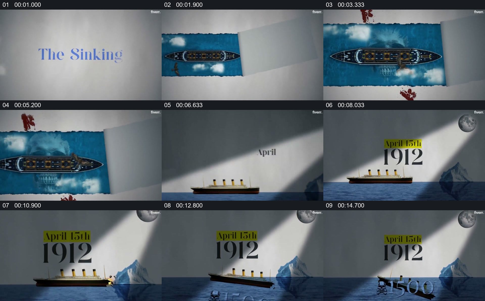

# 把船、日期和冰山放进同一舞台来展示事件

- 作品：案例 139（原批次 N02）《泰坦尼克号纪录片样片》；[公开来源](https://www.fiverr.com/bimdasboy420/edit-vox-style-documentary-video-with-map-animation-and-motion-graphics)。
- 原片范围：00:00.000—00:16.100，源时间，含起点、不含终点；[本地来源视频](../video.mp4)｜[本卡片段](c01.mp4)。
- 范围依据：从俯视船只建立，到侧视船与冰山、日期和下沉状态；16 秒后切换到新闻资料。
- 观察方式与未确认范围：本轮查看整段来源的 64 帧时间序列及本卡九格，未独立完成连续原速观看；抽帧之间的连续运动、交叠、速度和停顿均待复核。本地视频有音轨，但本轮未完成听审。作品分析不等同于作者意图；迁移方法尚未在新项目实做。
- 原批次编号：N02-c01；正式编号：139-c01。

## 原画面具体怎样设计

浅色桌面上出现蓝色水面长条，船只从俯视角度置于其上；后续抽帧中水面与船占据更大区域。场景换成侧视构图：船位于左侧水面，冰山位于右侧，上方是月亮和一束斜向光。

“April 15th 1912”分行出现在船上方。后面的画面中船靠近冰山、倾斜并部分没入水面，底部出现大数字。画面是示意性模型与图形，不能直接视为历史录像。

## 为什么这样设计，好在哪里

作品分析：俯视与侧视分别提供全貌和事件中的相对位置；日期与模型同屏，让事件时间有明确归属。船体倾斜和水面遮挡让结果可见，但不能据此推断碰撞和沉没的实际全过程或数字准确性。

## 可直接使用的创意指令

选有可靠资料的事件，将关键对象和环境做成明确标注的示意舞台；先展示对象关系，再在同一空间中呈现必要的状态变化与事件时间，最后保留能解释结果的画面。模型风格、视角和色彩均可换；应将重建与真实影像区分，且不为顺畅动画补造未经证实的动作。
