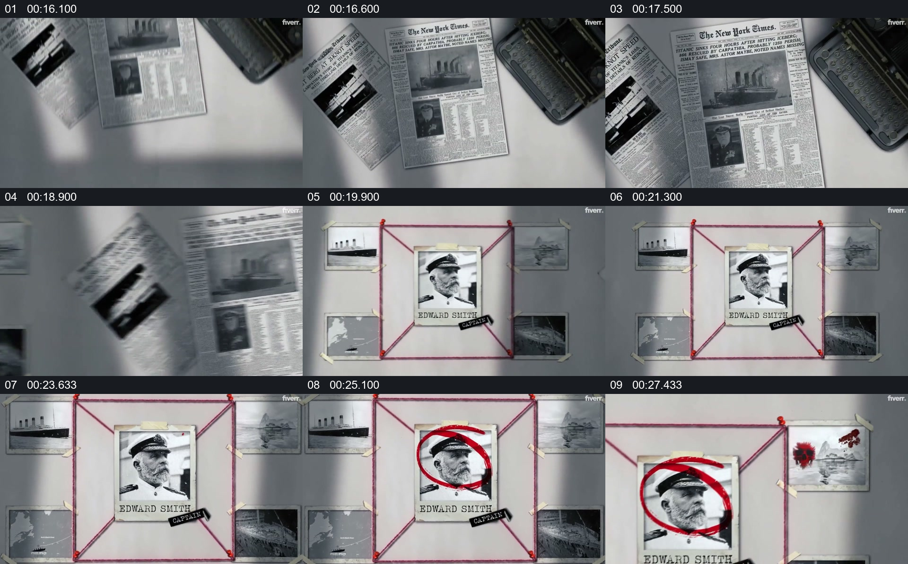

# 由新闻资料切到人物证据墙，集中查看一位角色

- 作品：案例 139（原批次 N02）《泰坦尼克号纪录片样片》；[公开来源](https://www.fiverr.com/bimdasboy420/edit-vox-style-documentary-video-with-map-animation-and-motion-graphics)。
- 原片范围：00:16.000—00:28.400，源时间，含起点、不含终点；[本地来源视频](../video.mp4)｜[本卡片段](c02.mp4)。
- 范围依据：从报纸资料到船长肖像及周围照片的关系墙，再放大局部；随后进入宣传收尾。
- 观察方式与未确认范围：本轮查看整段来源的 64 帧时间序列及本卡九格，未独立完成连续原速观看；抽帧之间的连续运动、交叠、速度和停顿均待复核。本地视频有音轨，但本轮未完成听审。作品分析不等同于作者意图；迁移方法尚未在新项目实做。
- 原批次编号：N02-c02；正式编号：139-c02。

## 原画面具体怎样设计

多张报纸与一本深色册子排在浅色桌面上，其中一张报纸呈现船舶图片。随后画面变为人物证据墙：中央是 Edward Smith 的肖像卡，周围分布船只和其他照片，红线连接在外围图钉附近。

肖像上随后出现红色圆圈，中央人物和照片墙同时保留；后续抽帧中画面更靠近右上方的小照片，红线及旁侧人物卡仍可见。

## 为什么这样设计，好在哪里

作品分析：报纸建立资料环境，人物墙把一位角色放在多个相关图片之间；圆圈改变视觉主次而没有清空周围参照。画面中的线、标记和照片只是叙事组织，不足以证明责任、因果或每张照片与该人物的关系。

## 可直接使用的创意指令

先选可核验的新闻或档案材料建立事件背景，再将需要介绍的人物及真实相关材料放进同一关系空间；用少量圈点和连接突出当前查看对象，保留足够的上下文。放大某张材料时确保身份和来源清楚。纸面、图钉与线色可以换；连接仅表达有证据的关系，未经核验不要暗示责任或因果。
