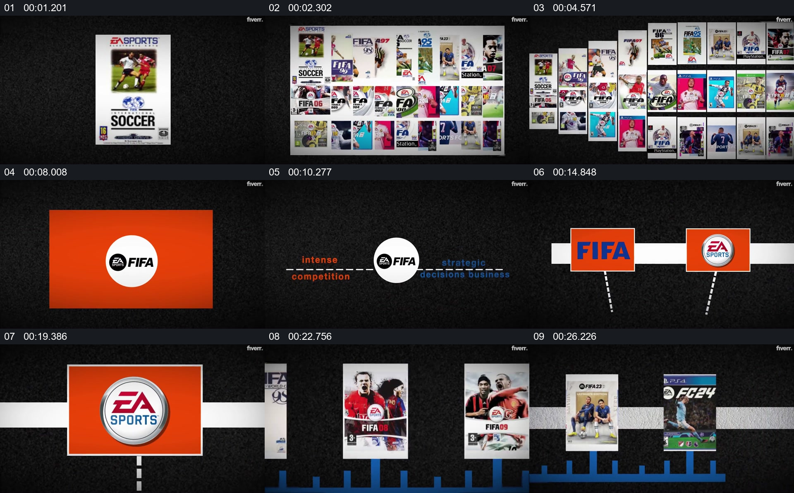

# 从系列封面集合进入品牌关系，再展开作品时间线

- 作品：案例 140（原批次 N03）《FIFA游戏发展样片》；[公开来源](https://www.fiverr.com/ashabulnaeem/professional-youtube-social-media-ads-sport-commercial-and-educational-videos)。
- 原片范围：00:00.000—00:26.900，源时间，含起点、不含终点；[本地来源视频](../video.mp4)｜[本卡片段](c01.mp4)。
- 范围依据：由单张封面扩为系列集合，再呈现品牌关系，最终沿水平线展开多个版本封面；之后切换到数据图。
- 观察方式与未确认范围：本轮查看整段来源的 64 帧时间序列及本卡九格，未独立完成连续原速观看；抽帧之间的连续运动、交叠、速度和停顿均待复核。本地视频有音轨，但本轮未完成听审。作品分析不等同于作者意图；迁移方法尚未在新项目实做。
- 原批次编号：N03-c01；正式编号：140-c01。

## 原画面具体怎样设计

黑色背景中央先是一张足球游戏封面，随后多张不同时期的封面构成紧密集合。画面再转为品牌标志与文字，两个标志先后在同一水平关系中出现，并通过一条明亮的横带组织在一起。

接下来的时间线下方有一排蓝色柱形，多个游戏封面沿横向依次排列；部分封面占据更大位置，品牌标志与共同横线提供整组视觉参照。

## 为什么这样设计，好在哪里

作品分析：先看到单件，再看到成系列的封面，观众容易理解后续展示的是一个持续发展的对象；横线将不同年份的作品放到同一观察方向。标志及封面仅代表作品中呈现的版本，不能据画面推定准确发行顺序、合作关系或柱形数据含义。

## 完整照排指令

以[完整原片](../video.mp4)的 0–26.9 秒为准。画幅 1280×720，源帧率 30000/1001。以下拍点为抽帧定位，位置按画幅百分比取近似值。

### 源时刻照排

- 0–约 8 秒，黑色细纹底中先放一张竖幅【早期封面】，保留四面留黑。随后【历年封面】依次补成紧密矩阵，最后横向压成一排。
- 约 8–20 秒，封面退给橙底圆形【联合标志】。黑底复现标志，两侧用橙、蓝小号【品牌说明】区分。接着将【品牌甲】【品牌乙】各放橙色矩形牌，细虚线向下连，白色横带从牌后穿过，视点再聚向右侧品牌。
- 约 20–26.9 秒，竖幅封面沿共同横向时间线更换，下方以蓝色【时间线柱形】铺成统一基线，个别封面放大。保留序列和白带位置，26.9 秒进入独立产品比较。

### 用料与取用

【早期封面】【历年封面】提供同一系列的授权图、发行年和顺序，前段矩阵与后段时间线应能认出相同版本。横向浏览可用静图一次排列或移位，动态封面须在其入出点内连续且不循环、不用照片运镜冒充实际预告内容。【联合标志】【品牌甲】【品牌乙】【品牌说明】须按实际授权、合作关系及时间解释，附可核对发行商或官方档案。【时间线柱形】若有数量含义，交数据、单位和来源；若仅作刻度则不赋予虚构数据。只有历年封面可单取 0–约 8 秒或约 20–26.9 秒；只有合作资料可单用约 8–20 秒。

### 验证状态

已对照原片等距抽帧与卡稿，核对单封面到矩阵、双标志的横带及封面时间线。细字、帧级切点、原速听看与试摆待核。
