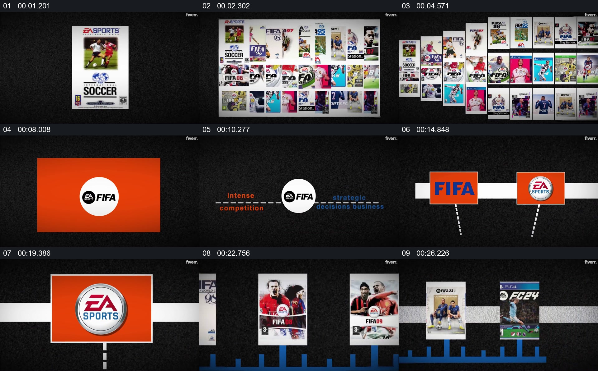

# 从系列封面集合进入品牌关系，再展开作品时间线

- 作品：案例 140（原批次 N03）《FIFA游戏发展样片》；[公开来源](https://www.fiverr.com/ashabulnaeem/professional-youtube-social-media-ads-sport-commercial-and-educational-videos)。
- 原片范围：00:00.000—00:26.900，源时间，含起点、不含终点；[本地来源视频](../video.mp4)｜[本卡片段](c01.mp4)。
- 范围依据：由单张封面扩为系列集合，再呈现品牌关系，最终沿水平线展开多个版本封面；之后切换到数据图。
- 观察方式与未确认范围：本轮查看整段来源的 64 帧时间序列及本卡九格，未独立完成连续原速观看；抽帧之间的连续运动、交叠、速度和停顿均待复核。本地视频有音轨，但本轮未完成听审。作品分析不等同于作者意图；迁移方法尚未在新项目实做。
- 原批次编号：N03-c01；正式编号：140-c01。

## 原画面具体怎样设计

黑色背景中央先是一张足球游戏封面，随后多张不同时期的封面构成紧密集合。画面再转为品牌标志与文字，两个标志先后在同一水平关系中出现，并通过一条明亮的横带组织在一起。

接下来的时间线下方有一排蓝色柱形，多个游戏封面沿横向依次排列；部分封面占据更大位置，品牌标志与共同横线提供整组视觉参照。

## 为什么这样设计，好在哪里

作品分析：先看到单件，再看到成系列的封面，观众容易理解后续展示的是一个持续发展的对象；横线将不同年份的作品放到同一观察方向。标志及封面仅代表作品中呈现的版本，不能据画面推定准确发行顺序、合作关系或柱形数据含义。

## 可直接使用的创意指令

选择可确认时间和身份的一组系列作品，先展示一件具有辨识度的材料，再扩大为集合。若要解释品牌与历史，在连续时间轴上标注真实日期或版本，并把封面、标志与对应节点绑定；保持同一基准以便比较。颜色、方向和封面数量可变；未核对的顺序或数据不应伪装成精确历史。
