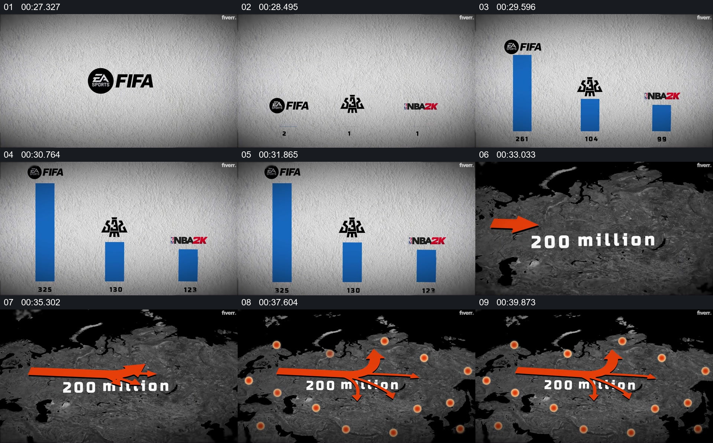

# 先并列比较数量，再把规模投向地图

- 作品：案例 140（原批次 N03）《FIFA游戏发展样片》；[公开来源](https://www.fiverr.com/ashabulnaeem/professional-youtube-social-media-ads-sport-commercial-and-educational-videos)。
- 原片范围：00:26.900—00:40.600，源时间，含起点、不含终点；[本地来源视频](../video.mp4)｜[本卡片段](c02.mp4)。
- 范围依据：从三组数值的并列柱形图，到地图上的总数与地点标记；随后进入人物关系图。
- 观察方式与未确认范围：本轮查看整段来源的 64 帧时间序列及本卡九格，未独立完成连续原速观看；抽帧之间的连续运动、交叠、速度和停顿均待复核。本地视频有音轨，但本轮未完成听审。作品分析不等同于作者意图；迁移方法尚未在新项目实做。
- 原批次编号：N03-c02；正式编号：140-c02。

## 原画面具体怎样设计

浅灰背景上依次出现三个产品标志及各自的蓝色柱形和数字，左侧柱形明显高于另外两项；三个对象保持在同一水平区域，便于直接比较。

随后画面转为深色世界地图，中央显示“200 million”，橙色箭头和圆点分布于地图不同位置。数字、地图和标记同屏，之后转到另一组品牌与人物画面。

## 为什么这样设计，好在哪里

作品分析：共同基线与并列标志把数字归属于各自对象；地图将注意力从组间差异转向地理范围。图形上的箭头和圆点有视觉引导作用，但这里没有核验统计年份、单位、地点及其实际含义。

## 完整照排指令

以[完整原片](../video.mp4)的 26.9–40.6 秒为准。画幅 1280×720，源帧率 30000/1001。以下拍点为抽帧定位，位置按画幅百分比取近似值。

### 源时刻照排

- 26.9–约 32 秒，浅灰暗角底，先居中排【产品标志】之一，再在同一横向基线上建立三项。每项标志下布同宽蓝色【对比柱形】，柱脚下排黑色【对比数字】，左柱升高后保持，其他两项留足间隔。
- 约 32–40.6 秒，整幅切灰黑【世界地图】，中央大字距白色【汇总数字】；左侧橙色【方向箭头】沿水平线伸向主区，再补转向，与随后出现的【地图圆点】叠在地图上方。保留中央数字直至场面结束，切向下一组品牌及人物画面。

### 用料与取用

三组【产品标志】【对比柱形】【对比数字】来自同一口径与同一统计期，交单位、可核对表项及对应关系。柱形全拍共用零点与尺度，26.9–约 32 秒各项建立后保留至切地图，禁循环和定格替代数值增长，末态可停。【世界地图】【汇总数字】【方向箭头】【地图圆点】须有可核对的数据定义与适用区域；若箭头或圆点只作示意，须说明，避免暗示不存在的流向或分布。地图约 32–40.6 秒持续同一视域，可用静图配分层标记。只有跨产品数据可取前拍；只有地图数字及相应证据可取后拍。

### 验证状态

已对照原片密集抽帧与卡稿，核查共用柱形基线、地图数字及橙色标记逐步建立。原速听看、精确切点、原数细节及试摆待核。
