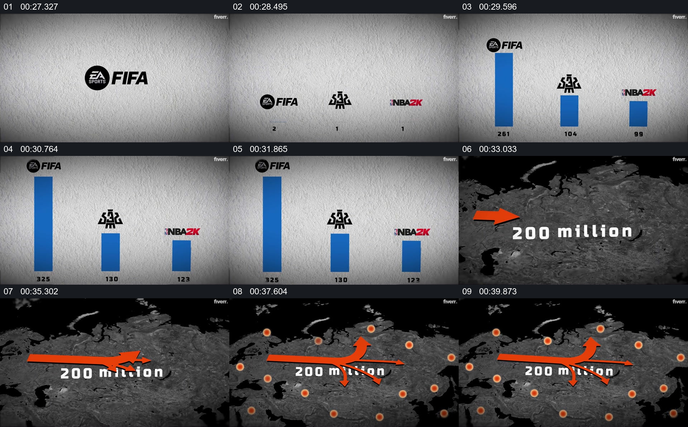

# 先并列比较数量，再把规模投向地图

- 作品：案例 140（原批次 N03）《FIFA游戏发展样片》；[公开来源](https://www.fiverr.com/ashabulnaeem/professional-youtube-social-media-ads-sport-commercial-and-educational-videos)。
- 原片范围：00:26.900—00:40.600，源时间，含起点、不含终点；[本地来源视频](../video.mp4)｜[本卡片段](c02.mp4)。
- 范围依据：从三组数值的并列柱形图，到地图上的总数与地点标记；随后进入人物关系图。
- 观察方式与未确认范围：本轮查看整段来源的 64 帧时间序列及本卡九格，未独立完成连续原速观看；抽帧之间的连续运动、交叠、速度和停顿均待复核。本地视频有音轨，但本轮未完成听审。作品分析不等同于作者意图；迁移方法尚未在新项目实做。
- 原批次编号：N03-c02；正式编号：140-c02。

## 原画面具体怎样设计

浅灰背景上依次出现三个产品标志及各自的蓝色柱形和数字，左侧柱形明显高于另外两项；三个对象保持在同一水平区域，便于直接比较。

随后画面转为深色世界地图，中央显示“200 million”，橙色箭头和圆点分布于地图不同位置。数字、地图和标记同屏，之后转到另一组品牌与人物画面。

## 为什么这样设计，好在哪里

作品分析：共同基线与并列标志把数字归属于各自对象；地图将注意力从组间差异转向地理范围。图形上的箭头和圆点有视觉引导作用，但这里没有核验统计年份、单位、地点及其实际含义。

## 可直接使用的创意指令

先定义同单位、同时间范围的比较对象，把真实数值和清晰标签放在共同基线；若需要进一步解释地理覆盖，另用有来源的地图标记具体位置，并说明数字与地图之间的关系。色彩和图形形式可更换；不要把销售量、用户量和地区覆盖等不同口径混成同一个数据。
