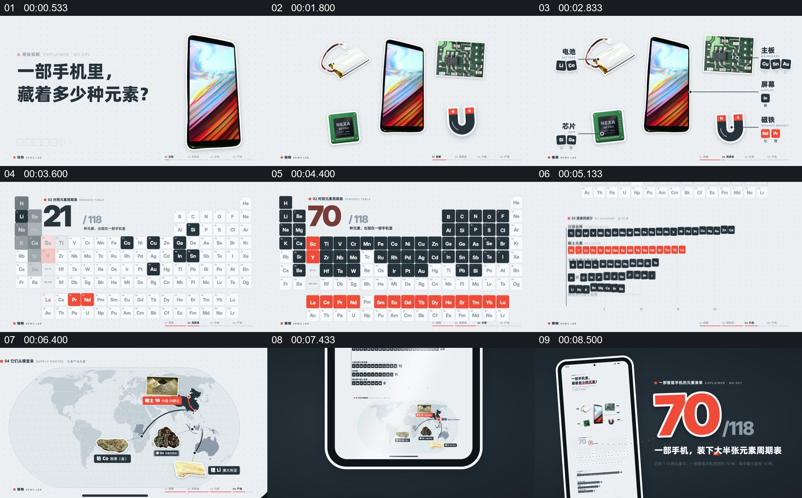

# 从手机部件展开元素，再把数量收回到整机

- 作品：案例 141（原批次 N05）《手机里藏着多少种元素》；[公开来源](https://vincentwei1021.github.io/mg-styles-15/videos/19-paperclip.mp4)。
- 原片范围：00:00.000—00:10.000，源时间，含起点、不含终点；[本地来源视频](../video.mp4)｜[本卡片段](../video.mp4)。
- 范围依据：从手机和提问建立，到部件、元素表、分类和地图，再回到手机及核心数量结论。
- 观察方式与未确认范围：本轮查看整段来源的 40 帧时间序列及本卡九格，未独立完成连续原速观看；抽帧之间的连续运动、交叠、速度和停顿均待复核。本地视频有音轨，但本轮未完成听审。作品分析不等同于作者意图；迁移方法尚未在新项目实做。
- 原批次编号：N05-c01；正式编号：141-c01。

## 原画面具体怎样设计

白色版面上，一部手机与“藏着多少种元素”的问题并置。随后电池、芯片、主板及磁铁等示意图片围绕手机出现，旁边有名称与小型元素符号。

画面切到元素周期表，部分格子着色，左上数字逐步显示到 70/118；这些小格随后被重新排列成分组条列。世界地图、原料图片和连接标记出现后，整套信息被放进一部手机轮廓中，最后手机位于左侧，右侧以大号“70/118”总结。

## 为什么这样设计，好在哪里

作品分析：整机先承担问题，拆出的部件为元素来源提供具体位置；元素表与分组把大量名目组织成可以比较的结构，末尾重新回到手机，使抽象数字与日常对象重新建立联系。70/118、物料来源及地图连线是画面展示，尚未独立核验。

## 可直接使用的创意指令

选择一个确有组成信息的对象，先让观众辨认完整主体，再以真实部件图和简短名称展开内部构成。将经核实的类别或数量放到可比较的表格中，必要时用地图说明可追溯来源；最后回到整机，将最重要的数字与单位放在主体旁。可以更换表格与视觉形式，但必须保留部件、分类、数据及主体的对应，不能把示意材料当作实际供应链证据。
