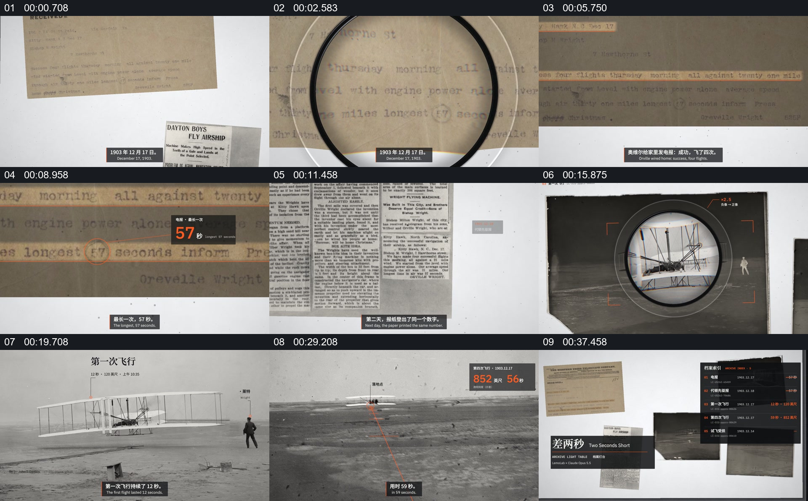

# 从档案局部走进历史影像，再回到证据对照

- 作品：案例 121（原批次 P04）《档案纸张与照片聚焦》；[公开来源](https://www.reclip.io/claude-opus-5-5-video-prompts/two-seconds-short-archive-light-table)。
- 原片范围：00:00.000—00:40.000，源时间，含起点、不含终点；[本地来源视频](../video.mp4)｜[本卡片段](../video.mp4)。
- 范围依据：从桌面上建立档案、放大文字，到两张飞行影像和数字对照回收至档案集合，围绕同一事件完成一轮调查式观看。
- 观察方式与未确认范围：本轮查看整段来源的 64 帧时间序列及本卡九格，未独立完成连续原速观看；抽帧之间的连续运动、交叠、速度和停顿均待复核。本地视频有音轨，但本轮未完成听审。作品分析不等同于作者意图；迁移方法尚未在新项目实做。
- 原批次编号：P04-c01；正式编号：121-c01。

## 原画面具体怎样设计

白色桌面上并置信件与报纸，圆形放大镜位于纸面文字上；之后纸面局部占据大部分画面，几行文字被依次强调，旁边出现黑底橙色数字卡。随后报纸版面进入，强调的文字从信件切换到新闻报道。

画面转到深色飞行照片，圆形镜片落在飞机附近；镜内由局部放大为更清楚的飞行场景。接下来的完整图像上方标出“第一次飞行”等文字，主体仍是飞机和旁边的人。另一张远景照片随后进入，出现数字、红色标记线与两张数值卡；最终镜片和照片收回到白色桌面，报纸、信件、影像及标题组成并列档案。

## 为什么这样设计，好在哪里

作品分析：纸面局部、照片中的飞机与统计数字分工不同：文字提供出处，镜片提供由局部到整体的观察入口，标注再把注意力送到同一事件的可比较结果。末尾把材料放回桌面，使此前被单独查看的证据重新获得整体关系；若只保留数字或把照片当背景，证据与结论的对应会弱化。材料是否为真实历史档案、具体史实和数字尚未另行核实。

## 可直接使用的创意指令

适合已有可核对原始材料和影像的解释段。先在共同桌面或档案空间建立文件及照片，让一个明确的局部成为观看入口；将可辨认的原文与它所指的影像分阶段放大，再在主体仍可辨识时加入对应数字或比较标记。完成一项判断后把材料及结果重新并列，使观众能回认来源。纸张、镜片、配色可替换为适合内容的容器；保留局部、证据影像与结果之间的指向关系。资料不足或数字无法核对时不应借包装暗示证据已获确认。
