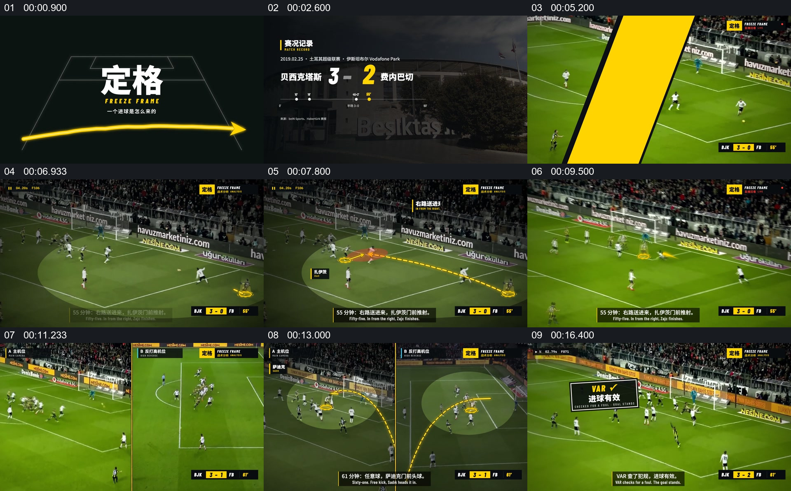

# 先回到比赛现场，再用并列视角解释判定

- 作品：案例 122（原批次 P06）《比赛画面定格与路线标注》；[公开来源](https://www.reclip.io/claude-opus-5-5-video-prompts/freeze-frame-football-telestrator)。
- 原片范围：00:00.000—00:18.200，源时间，含起点、不含终点；[本地来源视频](../video.mp4)｜[本卡片段](c01.mp4)。
- 范围依据：保留比分及现场建立、第一次路线标注、双机位比较和判定结果；随后进入另一段比赛回放。
- 观察方式与未确认范围：本轮查看整段来源的 64 帧时间序列及本卡九格，未独立完成连续原速观看；抽帧之间的连续运动、交叠、速度和停顿均待复核。本地视频有音轨，但本轮未完成听审。作品分析不等同于作者意图；迁移方法尚未在新项目实做。
- 原批次编号：P06-c01；正式编号：122-c01。

## 原画面具体怎样设计

黑底标题之后，比分和比赛名称先覆盖在球场背景上，观众先知道正在看哪场比赛。随后比赛转播式画面占满画面；球员与球门仍可见，球场局部被压暗或提亮，黄色标记和曲线叠在传球及球员位置附近。

后续画面分成左右两个比赛视角，两侧各保留同一进攻区域，黄色线、圈与文字提示把注意指向球员位置。比较完成后回到较大的场地画面，黑黄“VAR”提示卡覆盖其上，给出这一段判定的视觉结果。

## 为什么这样设计，好在哪里

作品分析：先展示未被图形取代的比赛场景，再把标记放到人物、球和空间关系附近，能把观众的视线引向需要比较的位置。左右画面允许两个观察角度同时存在；结果卡则让比较有明确出口。仅凭静帧无法确认两个机位是否严格同步，也未核实这是否为真实比赛录像或判罚是否正确。

## 可直接使用的创意指令

选择来源一致、时间可核对的两个机位，先给出完整现场和关键参与者，再在需要解释的时点保留原图位置，叠加少量路线、范围或对象标签。确需比较时并置两个视角，让同一对象或同一空间在两侧均可辨认；结束后用简短结论接回现场。标记颜色、版式和机位数量可变，但指示对象必须与真实画面对应；缺少同步依据时应标明，不以示意图替代事实。
