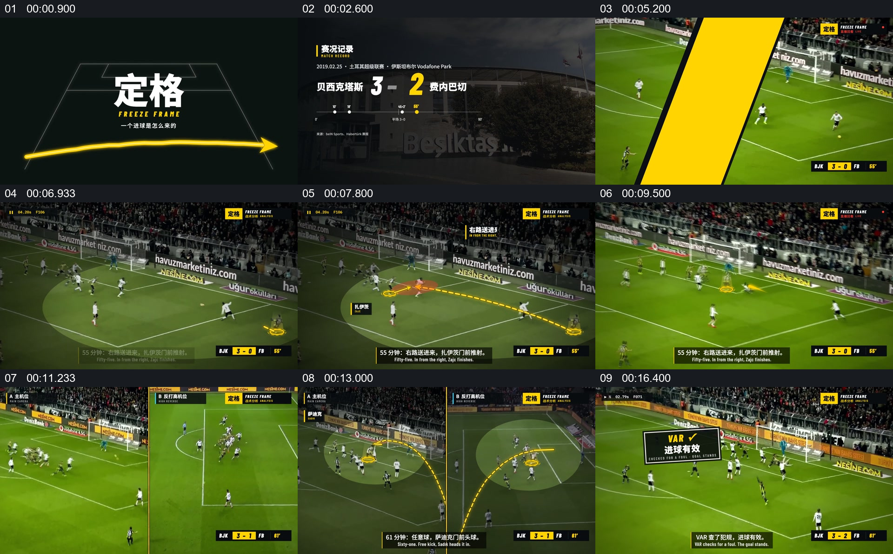

# 先回到比赛现场，再用并列视角解释判定

- 作品：案例 122（原批次 P06）《比赛画面定格与路线标注》；[公开来源](https://www.reclip.io/claude-opus-5-5-video-prompts/freeze-frame-football-telestrator)。
- 原片范围：00:00.000—00:18.200，源时间，含起点、不含终点；[本地来源视频](../video.mp4)｜[本卡片段](c01.mp4)。
- 范围依据：保留比分及现场建立、第一次路线标注、双机位比较和判定结果；随后进入另一段比赛回放。
- 观察方式与未确认范围：本轮查看整段来源的 64 帧时间序列及本卡九格，未独立完成连续原速观看；抽帧之间的连续运动、交叠、速度和停顿均待复核。本地视频有音轨，但本轮未完成听审。作品分析不等同于作者意图；迁移方法尚未在新项目实做。
- 原批次编号：P06-c01；正式编号：122-c01。

## 原画面具体怎样设计

黑底标题之后，比分和比赛名称先覆盖在球场背景上，观众先知道正在看哪场比赛。随后比赛转播式画面占满画面；球员与球门仍可见，球场局部被压暗或提亮，黄色标记和曲线叠在传球及球员位置附近。

后续画面分成左右两个比赛视角，两侧各保留同一进攻区域，黄色线、圈与文字提示把注意指向球员位置。比较完成后回到较大的场地画面，黑黄“VAR”提示卡覆盖其上，给出这一段判定的视觉结果。

## 为什么这样设计，好在哪里

作品分析：先展示未被图形取代的比赛场景，再把标记放到人物、球和空间关系附近，能把观众的视线引向需要比较的位置。左右画面允许两个观察角度同时存在；结果卡则让比较有明确出口。仅凭静帧无法确认两个机位是否严格同步，也未核实这是否为真实比赛录像或判罚是否正确。

## 完整照排指令

以[完整原片](../video.mp4)的 0–18.2 秒为准。画幅 1920×1080，源帧率 30/1。以下拍点为抽帧定位，位置按画幅百分比取近似值。

### 源时刻照排

- 0–约 5 秒，暗底用大白字【分析标题】和黄箭起势，再于暗化【球场建立画面】上排【比赛名称】【比分】。白色和黄色比分居中并列，队伍及小赛事资料保持次级。
- 约 5–11 秒，满幅【比赛主视角】接管，画内比赛状态条放边缘，局部暗层压低无关区域，亮圈、短线和【传球路径】覆盖相应球员及球路。底边给【解说短句】，分析标记出现前保留一段可辨队形的实播。
- 约 11–15 秒，左右并列【回放视角甲】【回放视角乙】，中间细黄分界。两侧保留各自画面状态，圈亮同一相关球员或位置，底边继续保留【解说短句】，辅以【比较标记】。
- 约 15–18.2 秒，回到大幅比赛视角，中间叠黑底黄白【判定结果卡】，球场和球员仍为下层；保留结果到本卡出点。

### 用料与取用

【球场建立画面】【比赛主视角】【回放视角甲】【回放视角乙】需要同一场比赛的同一回合，有可核对比赛时间和镜头起止；分屏用同一动作节点对齐，两窗自约 11 秒起持续至约 15 秒一起退出。交足长实录和可辨球员与球门，允许按分析需要同步短停在判读帧，禁止循环或用照片运镜替代回合过程。约 5 秒建立的主视角在结果拍重入时应能定位到同一进攻场景。供【分析标题】【比赛名称】【比分】【传球路径】【解说短句】【比较标记】【判定结果卡】，使用可核对的赛事转播、官方结果或判定说明，区分观察与判决。仅具单视角可用约 5–11 秒；仅有同步双视角可用约 11–15 秒，省去无出处的判定。

### 验证状态

已对照原片等距抽帧与卡稿，核查比分压场、同回合分屏和回到大画面叠结果。双窗准确同步帧、原速听看及换料试摆待核。
