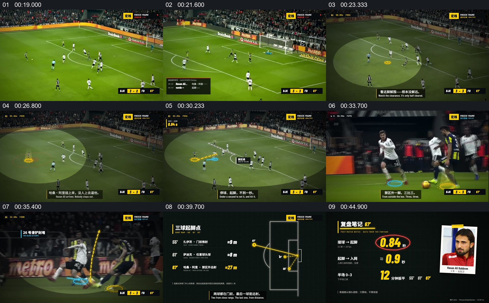

# 在比赛回放画面上逐层解释空位、动作与结果

- 作品：案例 122（原批次 P06）《比赛画面定格与路线标注》；[公开来源](https://www.reclip.io/claude-opus-5-5-video-prompts/freeze-frame-football-telestrator)。
- 原片范围：00:18.130—00:46.700，源时间，含起点、不含终点；[本地来源视频](../video.mp4)｜[本卡片段](c02.mp4)。
- 范围依据：从新的进攻回放建立空间，到局部提示、近景动作和球场示意及人物数字总结；不把各条标记拆成独立卡。
- 观察方式与未确认范围：本轮查看整段来源的 64 帧时间序列及本卡九格，未独立完成连续原速观看；抽帧之间的连续运动、交叠、速度和停顿均待复核。本地视频有音轨，但本轮未完成听审。作品分析不等同于作者意图；迁移方法尚未在新项目实做。
- 原批次编号：P06-c02；正式编号：122-c02。

## 原画面具体怎样设计

场地广角中，进攻球员、对手及球门同时可见。画面局部逐次变暗或被浅色椭圆强调，球员脚下有彩色圈点，短标签与虚线路线出现在空位和相关球员附近；随后又回到没有大面积遮挡的球场画面。

之后视角转到球员带球的近景，圈点贴近脚部，黄色弧线在射门画面附近出现。结尾改为深色平面：球场线框、几条方向线和数字组成一张战术概要，再以球员照片与数值卡呈现该次表现的统计结果。

## 为什么这样设计，好在哪里

作品分析：广角保留场上相对位置，局部明暗与圈点让观众能在复杂人群中定位；近景补充脚下动作，抽象球场图把看过的空间关系压缩成可比较的结果。数值卡负责收尾而非取代原回放。画面是否为真实比赛录像、动作是否准确对齐、统计意义及实际判罚仍需连续观看和来源核对。

## 完整照排指令

以[完整原片](../video.mp4)的 18.13–46.7 秒为准。画幅 1920×1080，源帧率 30/1。以下拍点为抽帧定位，位置按画幅百分比取近似值。

### 源时刻照排

- 18.13–约 34 秒，【回合广角】满幅，球门与禁区留在同一坐标，右上放小黄【回放标】、右下黑黄【比分牌】。先让队形可见，再以暗蒙版留下浅色椭圆，逐次叠【球员圈点】【战术短签】【跑位路线】。脚下标记跟随球员，虚线贴草地视角；每组分析完成后撤掉遮罩，让实播承接。
- 约 34–38 秒，从广角切同一回合的【带球近景】，圈点收紧到触球脚下。黄弧在射门画面附近建立，避开球与球门；【解说短句】贴底。
- 约 38–43 秒，退出实拍，深色平面右边画【战术线框】，用黄线与箭头回顾经过，左侧以白字、黄数字分行排【战术概要】，使路径与文字逐步相配。
- 约 43–46.7 秒，换深底统计板，左列大号黄字【表现数据】，右侧倾斜白底【球员肖像卡】。重点数字描圈，其余数据依次补齐，在统计结果停留后切出。

### 用料与取用

【回合广角】【带球近景】须取同场同一进攻，提供事件顺序、比赛计时及足长实播。广角自 18.13 秒持续到约 34 秒，允许标注拍短暂停在真实帧，禁循环或照片运镜替代球路；近景起点须能与广角动作接上。【回放标】【比分牌】【球员圈点】【战术短签】【跑位路线】【解说短句】【战术线框】【战术概要】【表现数据】【球员肖像卡】均关联同一场次及球员，给赛事原片、官方统计或可复核事件记录、数据单位和肖像来源。示意线路与可直接观察的线路须在文案中可区分。材料只齐一个环节时可取 18.13–约 34 秒广角、约 34–38 秒近景或约 38–46.7 秒有据的图表总结，各保留自身的上下文。

### 验证状态

已对照原片等距抽帧与卡稿，核对局部聚光、圈点随人定位、实拍到战术板和统计板。动作同步帧、原速听看与换料试摆待核。
