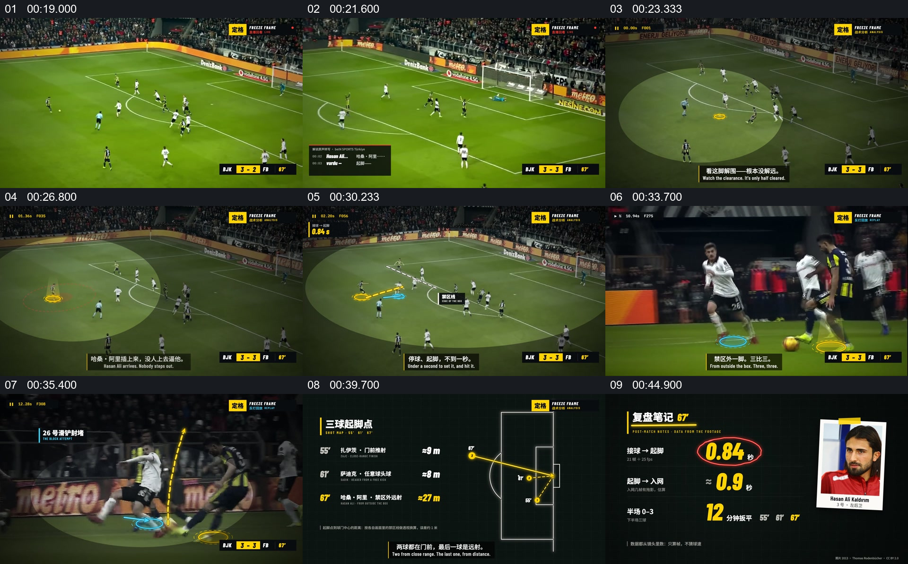

# 在比赛回放画面上逐层解释空位、动作与结果

- 作品：案例 122（原批次 P06）《比赛画面定格与路线标注》；[公开来源](https://www.reclip.io/claude-opus-5-5-video-prompts/freeze-frame-football-telestrator)。
- 原片范围：00:18.130—00:46.700，源时间，含起点、不含终点；[本地来源视频](../video.mp4)｜[本卡片段](c02.mp4)。
- 范围依据：从新的进攻回放建立空间，到局部提示、近景动作和球场示意及人物数字总结；不把各条标记拆成独立卡。
- 观察方式与未确认范围：本轮查看整段来源的 64 帧时间序列及本卡九格，未独立完成连续原速观看；抽帧之间的连续运动、交叠、速度和停顿均待复核。本地视频有音轨，但本轮未完成听审。作品分析不等同于作者意图；迁移方法尚未在新项目实做。
- 原批次编号：P06-c02；正式编号：122-c02。

## 原画面具体怎样设计

场地广角中，进攻球员、对手及球门同时可见。画面局部逐次变暗或被浅色椭圆强调，球员脚下有彩色圈点，短标签与虚线路线出现在空位和相关球员附近；随后又回到没有大面积遮挡的球场画面。

之后视角转到球员带球的近景，圈点贴近脚部，黄色弧线在射门画面附近出现。结尾改为深色平面：球场线框、几条方向线和数字组成一张战术概要，再以球员照片与数值卡呈现该次表现的统计结果。

## 为什么这样设计，好在哪里

作品分析：广角保留场上相对位置，局部明暗与圈点让观众能在复杂人群中定位；近景补充脚下动作，抽象球场图把看过的空间关系压缩成可比较的结果。数值卡负责收尾而非取代原回放。画面是否为真实比赛录像、动作是否准确对齐、统计意义及实际判罚仍需连续观看和来源核对。

## 可直接使用的创意指令

选一段具有明确动作结果的真实影像，先展示足以辨认各方站位的广角；每次只突出当前要解释的对象或空间，其他球员和场地维持位置参照。需要细节时切到对应近景，最后用与实际站位相符的简图或少量数据复述关键关系。可改用框线、标签或明暗，而应保留真实影像、重点对象和总结之间的对应；无法确认时间或统计来源时不要写成确定结论。
