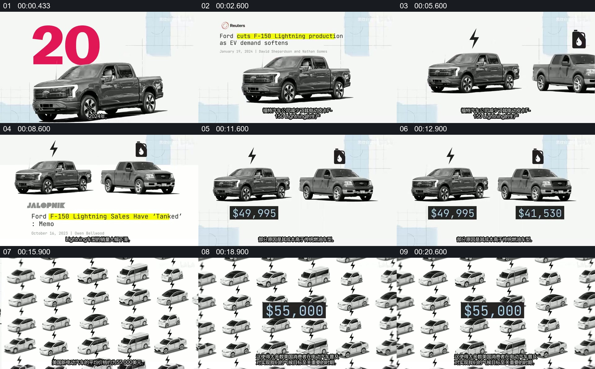

# 从单车新闻到两车型对照，再扩成整体价格背景

- 作品：案例 123（原批次 P08）《汽车图片与新闻信息_前27秒》；[公开来源](https://www.youtube.com/watch?v=rkxMdmipYqM)。
- 原片范围：00:00.000—00:21.000，源时间，含起点、不含终点；[本地来源视频](../video.mp4)｜[本卡片段](c01.mp4)。
- 范围依据：保留车型建立、新闻标题、两辆车及价格并列，到同类车辆图案与另一价格出现；21 秒后转入普通车展实拍。
- 观察方式与未确认范围：本轮查看整段来源的 64 帧时间序列及本卡九格，未独立完成连续原速观看；抽帧之间的连续运动、交叠、速度和停顿均待复核。本地视频有音轨，但本轮未完成听审。本地来源是原视频前 27 秒片段，非全长原片；画面为约 480p，带字幕及水印。作品分析不等同于作者意图；迁移方法尚未在新项目实做。
- 原批次编号：P08-c01；正式编号：123-c01。

## 原画面具体怎样设计

白色网格背景上先出现一辆皮卡，大号年份位于车后方；随后新闻标题落在车辆上方，其中一句有黄色标记。原车旁又出现第二辆皮卡，两车上方分别配有闪电和油泵图标。

下一阶段两辆车仍并排，新闻文字切换，黑色价格牌分别出现在两车下方。之后大量小型车辆图案在右侧及背景中铺开，逐步占据画面，中央又出现一个价格牌。21 秒附近画面转向车展和汽车实拍。

## 为什么这样设计，好在哪里

作品分析：同一车辆首先承接新闻，加入另一车型后才形成比较；图标与价格牌贴近各自对象，使抽象价格有明确归属。后来的车辆集合把单次对比扩为类别层面。图片重复能表达规模，但本片画面本身不能证明价格的来源、统计口径或普遍适用性。

## 完整照排指令

以[完整原片](../video.mp4)的 0–21 秒为准。画幅 852×480，源帧率 30/1。以下拍点为抽帧定位，位置按画幅百分比取近似值。

### 源时刻照排

- 0–约 6 秒，浅白网格及淡蓝纸块铺底，中间偏下放【车辆甲】，其后大号红字【事件年份】。上方落【新闻标题甲】，对关键原句加黄色底线，留媒体名或出处位置。
- 约 6–14 秒，【车辆乙】加入右侧，保持两车底线、比例和观察方向相近，各车上方配【动力图标】。再在两车下方同位置放黑底【价格甲】【价格乙】，白字数字与单位清楚，期间【新闻标题乙】保留证据层。
- 约 14–21 秒，小型【车群纹样】从局部铺成白底整幅，重复车形形成密集节奏，中央黑色【补充价格牌】用更大数字接管视线。约 21 秒切向车展及实拍。

### 用料与取用

【车辆甲】【车辆乙】须给同一市场可比较配置的透明车辆图，交年份、版本、动力种类与视角；甲从 0 秒持续到车群接管，乙约 6 秒进入并与甲并列到约 14 秒，两车允许保持静图，尺寸与边距调整一次即可。【车群纹样】提供单独小车图案，可重复排列，禁止将图案数量暗示为实际销量，除非有数据及图例。【事件年份】【新闻标题甲】【新闻标题乙】【动力图标】【价格甲】【价格乙】【补充价格牌】供准确原文、媒体／厂商网址、发布日期、车型、币种、市场和价格口径。若只有一条新闻与车型图可取 0–6 秒；有同口径双价可独立用约 6–14 秒；只有后一数字须补它具体指什么，再用约 14–21 秒。

### 验证状态

已对照原片等距抽帧与卡稿，核对同位置价格、两车比较和满幅纹样交接。标题具体原文、帧级切点、原速听看及实际试摆待核。
