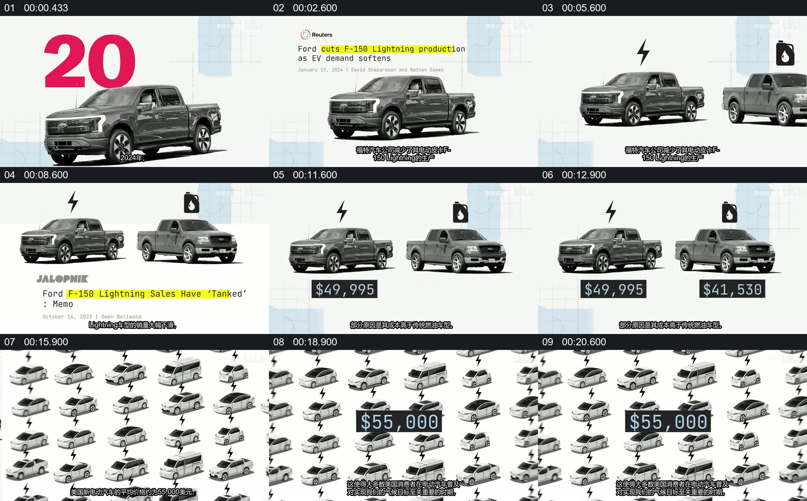

# 从单车新闻到两车型对照，再扩成整体价格背景

- 作品：案例 123（原批次 P08）《汽车图片与新闻信息_前27秒》；[公开来源](https://www.youtube.com/watch?v=rkxMdmipYqM)。
- 原片范围：00:00.000—00:21.000，源时间，含起点、不含终点；[本地来源视频](../video.mp4)｜[本卡片段](c01.mp4)。
- 范围依据：保留车型建立、新闻标题、两辆车及价格并列，到同类车辆图案与另一价格出现；21 秒后转入普通车展实拍。
- 观察方式与未确认范围：本轮查看整段来源的 64 帧时间序列及本卡九格，未独立完成连续原速观看；抽帧之间的连续运动、交叠、速度和停顿均待复核。本地视频有音轨，但本轮未完成听审。本地来源是原视频前 27 秒片段，非全长原片；画面为约 480p，带字幕及水印。作品分析不等同于作者意图；迁移方法尚未在新项目实做。
- 原批次编号：P08-c01；正式编号：123-c01。

## 原画面具体怎样设计

白色网格背景上先出现一辆皮卡，大号年份位于车后方；随后新闻标题落在车辆上方，其中一句有黄色标记。原车旁又出现第二辆皮卡，两车上方分别配有闪电和油泵图标。

下一阶段两辆车仍并排，新闻文字切换，黑色价格牌分别出现在两车下方。之后大量小型车辆图案在右侧及背景中铺开，逐步占据画面，中央又出现一个价格牌。21 秒附近画面转向车展和汽车实拍。

## 为什么这样设计，好在哪里

作品分析：同一车辆首先承接新闻，加入另一车型后才形成比较；图标与价格牌贴近各自对象，使抽象价格有明确归属。后来的车辆集合把单次对比扩为类别层面。图片重复能表达规模，但本片画面本身不能证明价格的来源、统计口径或普遍适用性。

## 可直接使用的创意指令

选择两类具有可比口径的真实对象，先用一张图和来源标题建立问题，再将第二对象放在可直接比较的位置，为每个对象分别标识类别和同口径数据。若讨论扩展到整体市场，用一组相关素材构成背景或集合，并让新的数据单独拥有清楚的适用范围。颜色、图标和对象数量均可改变；保留数字与对象的归属，并核验时间、货币和数据来源。
