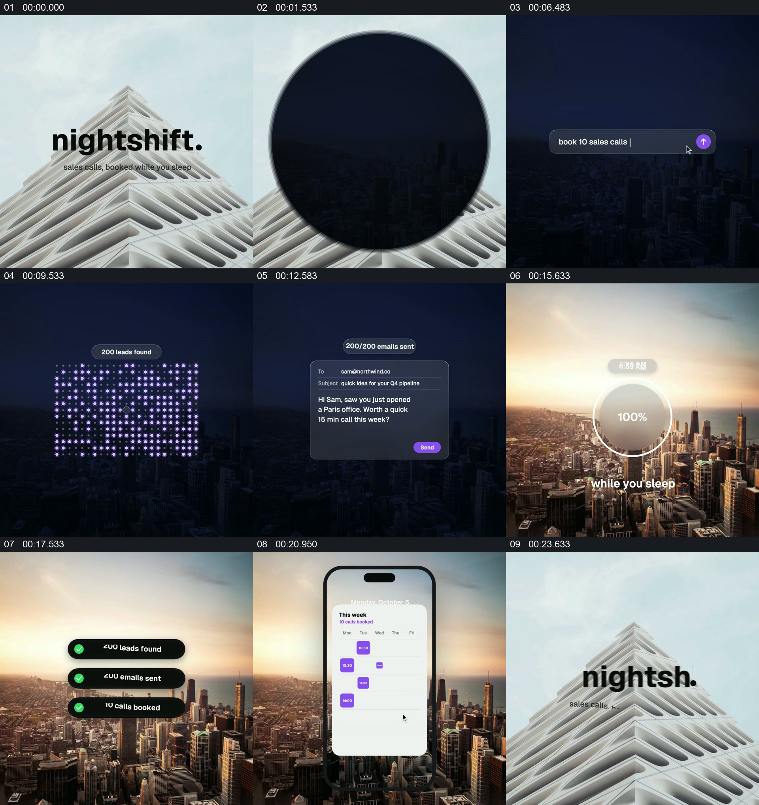

# 让城市从夜到早晨，承接一项任务的进度与结果

- 作品：案例 124（原批次 P12）《城市影像与界面文字》；[公开来源](https://www.reclip.io/claude-opus-5-5-video-prompts/nightshift-code-rendered-launch-film)。
- 原片范围：00:00.000—00:24.043，源时间，含起点、不含终点；[本地来源视频](../video.mp4)｜[本卡片段](../video.mp4)。
- 范围依据：建筑品牌开场转到夜景操作，进度伴随城市变亮，再以结果、手机页面和品牌收尾，构成一个完整的时间流逝演示。
- 观察方式与未确认范围：本轮查看整段来源的 64 帧时间序列及本卡九格，未独立完成连续原速观看；抽帧之间的连续运动、交叠、速度和停顿均待复核。本地视频有音轨，但本轮未完成听审。作品分析不等同于作者意图；迁移方法尚未在新项目实做。
- 原批次编号：P12-c01；正式编号：124-c01。

## 原画面具体怎样设计

白色建筑和品牌文字出现后，深色圆形扩大，画面进入夜间城市背景。“you log off at 6”和后续文字出现在城市前，接着中间出现输入框与一条安排任务的请求。

暗色城市作为持续背景，紫色点阵逐渐填充并显示数量；随后一张信息框出现，计数由零增加。界面收回后，圆形进度与时间显示在夜景中央，后续抽帧中城市变为日出，进度达到 100%。几条结果提示依次出现在城市上方，手机轮廓与通知、日历界面随后位于前景；最后圆形遮罩与建筑标志再次出现。

## 为什么这样设计，好在哪里

作品分析：夜间城市把抽象后台任务放进一段容易理解的时间；点阵、数字、进度和晨间提示分别承担执行与结果的可见状态。背景由夜到晨给多个界面阶段一个持续参照，手机则将后台结果落到具体的使用场景。产品流程和数值是作品中的演示，未验证真实服务能力。

## 可直接使用的创意指令

适合任务确有可核对起点、进度及结果的内容。先用环境或时间线建立开始状态，将用户发起的具体请求放在前景；保持一个可回认的环境参照，以少量界面状态表现处理进展，再让环境变化与进度结果共同表明经过了一段时间。最后把结果交给真实的查看位置，例如通知或报告。可更换城市、昼夜和点阵，但请求、执行状态与结果应相互对应，界面演示须与真实能力区分。
