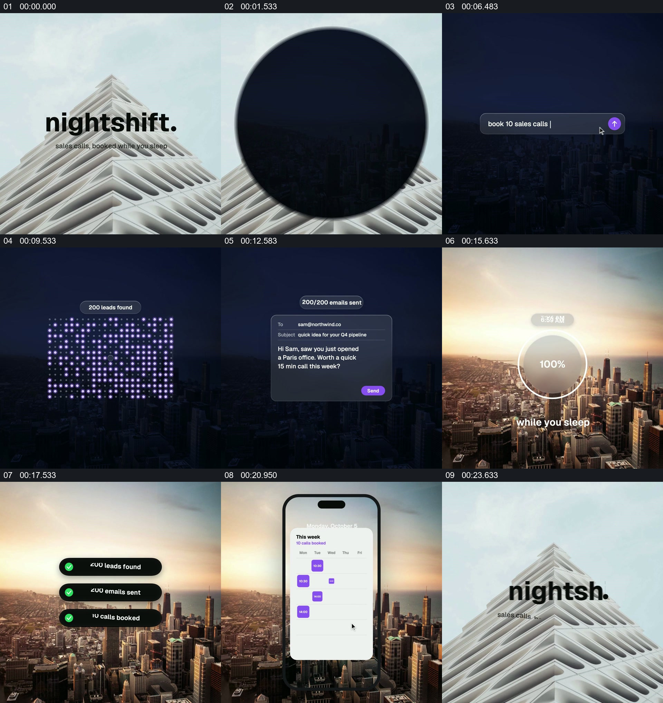

# 让城市从夜到早晨，承接一项任务的进度与结果

- 作品：案例 124（原批次 P12）《城市影像与界面文字》；[公开来源](https://www.reclip.io/claude-opus-5-5-video-prompts/nightshift-code-rendered-launch-film)。
- 原片范围：00:00.000—00:24.043，源时间，含起点、不含终点；[本地来源视频](../video.mp4)｜[本卡片段](../video.mp4)。
- 范围依据：建筑品牌开场转到夜景操作，进度伴随城市变亮，再以结果、手机页面和品牌收尾，构成一个完整的时间流逝演示。
- 观察方式与未确认范围：本轮查看整段来源的 64 帧时间序列及本卡九格，未独立完成连续原速观看；抽帧之间的连续运动、交叠、速度和停顿均待复核。本地视频有音轨，但本轮未完成听审。作品分析不等同于作者意图；迁移方法尚未在新项目实做。
- 原批次编号：P12-c01；正式编号：124-c01。

## 原画面具体怎样设计

白色建筑和品牌文字出现后，深色圆形扩大，画面进入夜间城市背景。“you log off at 6”和后续文字出现在城市前，接着中间出现输入框与一条安排任务的请求。

暗色城市作为持续背景，紫色点阵逐渐填充并显示数量；随后一张信息框出现，计数由零增加。界面收回后，圆形进度与时间显示在夜景中央，后续抽帧中城市变为日出，进度达到 100%。几条结果提示依次出现在城市上方，手机轮廓与通知、日历界面随后位于前景；最后圆形遮罩与建筑标志再次出现。

## 为什么这样设计，好在哪里

作品分析：夜间城市把抽象后台任务放进一段容易理解的时间；点阵、数字、进度和晨间提示分别承担执行与结果的可见状态。背景由夜到晨给多个界面阶段一个持续参照，手机则将后台结果落到具体的使用场景。产品流程和数值是作品中的演示，未验证真实服务能力。

## 完整照排指令

以[完整原片](../video.mp4)的 0–24.043 秒为准。画幅 1440×1440，源帧率 60/1。以下拍点为抽帧定位，位置按画幅百分比取近似值。

### 源时刻照排

- 0–约 5 秒，仰视浅白【品牌建筑】，深圆遮罩扩张切入【城市夜景】。居中白色中粗【开场对照句】分两次换行，留出城市地平线。
- 约 5–13 秒，夜景同位，中心横向【任务输入框】输入【任务原句】，右端紫色发送控件和指针依次动作。输入退场后【处理点阵】逐点被紫白填充，顶部小胶囊给【扫描计数】；随后用半透明【任务信息卡】和上方【发送计数】展现处理推进。
- 约 13–18 秒，卡片收回，居中细圆环【进度环】，上方小号【时刻】，圆内白色【完成百分比】。取景保持，夜景交暖色【城市晨景】，进度抵达终值，环下出现【夜间执行句】。
- 约 18–24.043 秒，在晨景中央依次堆叠深色【结果提示】，随后转为竖直【手机界面】，展示【通知内容】与【日历结果】。圆形遮幅收走城景，返回品牌建筑结束。

### 用料与取用

【城市夜景】【城市晨景】须同城市同可辨天际线及相容取景，约 3 秒起持续到约 22 秒，夜到晨可用同机位延时、匹配原片或两张对准的照片做光照交接，若演出需要云或街灯连续移动则用足长动态，不循环或定格补足。【任务输入框】【任务原句】【处理点阵】【扫描计数】【任务信息卡】【发送计数】【进度环】【时刻】【完成百分比】【结果提示】【手机界面】【通知内容】【日历结果】对应同一任务，交阶段数据、时间和可公开结果；真实产品主张附可核对版本、运行边界与出处，示例标明演示。【品牌建筑】【开场对照句】【夜间执行句】提供授权图和短句。只有任务处理可取约 5–13 秒；只有昼夜交替与经验证进度可用约 13–18 秒；只有真实结果可用约 18–22 秒。

### 验证状态

已对照原片等距抽帧与卡稿，核对夜景持续、晨景与进度交接、结果提示到手机。精确时间及计数、原速听看与实际试摆待核。
