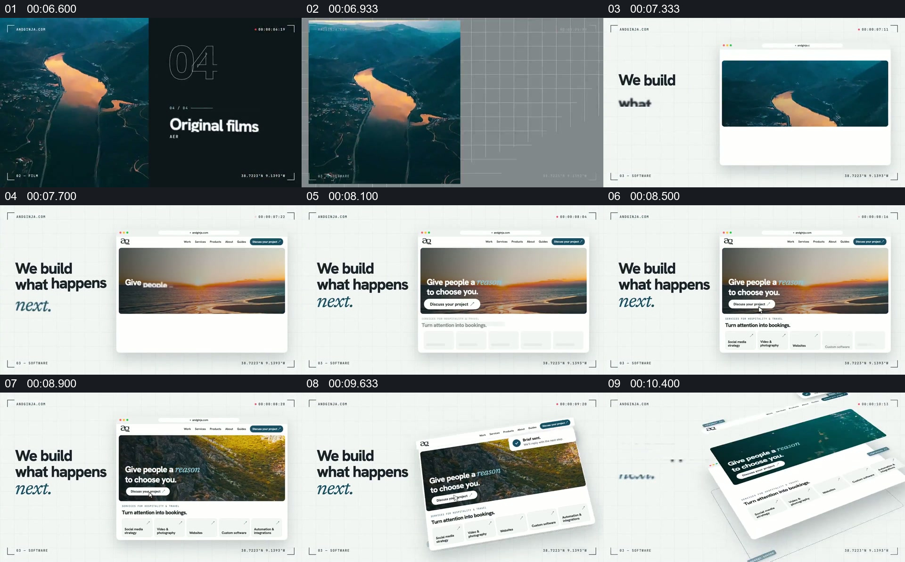

# 把作品画面装入网页，再让页面成为可观察的对象

- 作品：案例 125（原批次 P13）《实景画面文字与网页构图》；[公开来源](https://skillry.dev/ai-videos/opus-5-5/andginja-618685)。
- 原片范围：00:06.600—00:10.800，源时间，含起点、不含终点；[本地来源视频](../video.mp4)｜[本卡片段](c01.mp4)。
- 范围依据：以前一组素材中的河流画面进入为起点，展示网页框架、页面内容和倾斜后的完整页面；之后转入数据结果。
- 观察方式与未确认范围：本轮查看整段来源的 40 帧时间序列及本卡九格，未独立完成连续原速观看；抽帧之间的连续运动、交叠、速度和停顿均待复核。本地视频有音轨，但本轮未完成听审。作品分析不等同于作者意图；迁移方法尚未在新项目实做。
- 原批次编号：P13-c01；正式编号：125-c01。

## 原画面具体怎样设计

河流画面先在左侧占据高竖画幅；随后的白色空间里，左侧文字与右侧网页窗口并列，窗口中的横向图片最初沿用河流影像。之后窗口显示导航、横幅、标题与按钮，横幅内容换为海岸和其他景色。

后续抽帧中网页逐渐呈现更多区域，并在白色空间里转为倾斜的页面对象；左侧“what happens next”文字与页面并存，直到下一组大数字画面开始。

## 为什么这样设计，好在哪里

作品分析：素材先作为独立影像出现，再置于网页容器中，观众能理解它从视觉内容变成页面的一部分；左侧短句与右侧页面分工明确，倾斜视角进一步让页面整体成为被展示的作品。画面中的网页是宣传展示，不能据此认定是真实网站的操作录屏。

## 完整照排指令

以[完整原片](../video.mp4)的 6.6–10.8 秒为准。画幅 1280×720，源帧率 30/1。以下拍点为抽帧定位，位置按画幅百分比取近似值。

### 源时刻照排

- 6.6–7.5 秒，【河流影像】先在左侧高竖框出现，暗色右半逐渐让位给白色空间。河流随图框变小移至右侧【网页外框】的横向主图区，取景仍能看到同一道转弯；左侧黑色粗体【外侧标题】开始成行。
- 7.5–9.4 秒，窗口露出顶部【网页导航】及下方【网页首屏】。横幅先延续河流，继而换【海岸影像】等景色，画内叠小号白色【横幅文案】和亮按钮【按钮文字】。左侧标题保持左齐，末行用斜体；页面下段由上到下露出细栏。
- 9.4–10.8 秒，在白底上把同一网页对象偏转为斜透视，保留导航和首屏的相对位置。【外侧标题】先同屏，随后整组让位于大数字画面。

### 用料与取用

【河流影像】须能同时裁竖框和横幅且看出同一弯道，从 6.6 秒持续到约 7.6 秒首屏换图；若交动态，换裁切时保持播放相位，不循环或定格。其余【海岸影像】供可横裁的备选画面，自各自进入持续到下一图或窗口退出。若项目用照片，可以同源静图做框体位移与透视，不用照片运镜代替必须保留的河流运动。【网页外框】【网页导航】【网页首屏】【横幅文案】【按钮文字】交同一页面和真实字段，供可改透视的分层文件；【外侧标题】可拆成三行。只有单张同源图可取 6.6–约 7.6 秒，并在首屏落稳后切出；只有完整页面可取约 9.4–10.8 秒的姿态变化。

### 验证状态

已对照原片密集抽帧与卡稿，回查竖景转网页横幅、换景与斜置退出。跨窗口准确相位、原速听看与实际换料待核。
