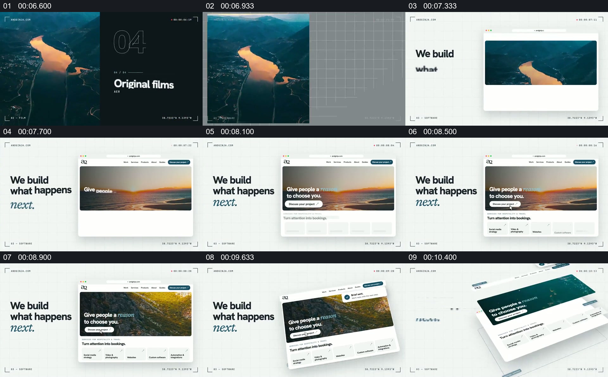

# 把作品画面装入网页，再让页面成为可观察的对象

- 作品：案例 125（原批次 P13）《实景画面文字与网页构图》；[公开来源](https://skillry.dev/ai-videos/opus-5-5/andginja-618685)。
- 原片范围：00:06.600—00:10.800，源时间，含起点、不含终点；[本地来源视频](../video.mp4)｜[本卡片段](c01.mp4)。
- 范围依据：以前一组素材中的河流画面进入为起点，展示网页框架、页面内容和倾斜后的完整页面；之后转入数据结果。
- 观察方式与未确认范围：本轮查看整段来源的 40 帧时间序列及本卡九格，未独立完成连续原速观看；抽帧之间的连续运动、交叠、速度和停顿均待复核。本地视频有音轨，但本轮未完成听审。作品分析不等同于作者意图；迁移方法尚未在新项目实做。
- 原批次编号：P13-c01；正式编号：125-c01。

## 原画面具体怎样设计

河流画面先在左侧占据高竖画幅；随后的白色空间里，左侧文字与右侧网页窗口并列，窗口中的横向图片最初沿用河流影像。之后窗口显示导航、横幅、标题与按钮，横幅内容换为海岸和其他景色。

后续抽帧中网页逐渐呈现更多区域，并在白色空间里转为倾斜的页面对象；左侧“what happens next”文字与页面并存，直到下一组大数字画面开始。

## 为什么这样设计，好在哪里

作品分析：素材先作为独立影像出现，再置于网页容器中，观众能理解它从视觉内容变成页面的一部分；左侧短句与右侧页面分工明确，倾斜视角进一步让页面整体成为被展示的作品。画面中的网页是宣传展示，不能据此认定是真实网站的操作录屏。

## 可直接使用的创意指令

先选一段能够代表内容的照片或视频，给观众足够时间辨认它，再将其放入页面、报告或其他实际展示容器。让容器的标题、导航与图片共同建立页面用途，之后改变观察距离以展示整体；旁侧文字只承担必要说明。可以调整画幅和页面形式，但素材到成品容器的身份关系应能被回认；页面功能和实际效果须另行核验。
