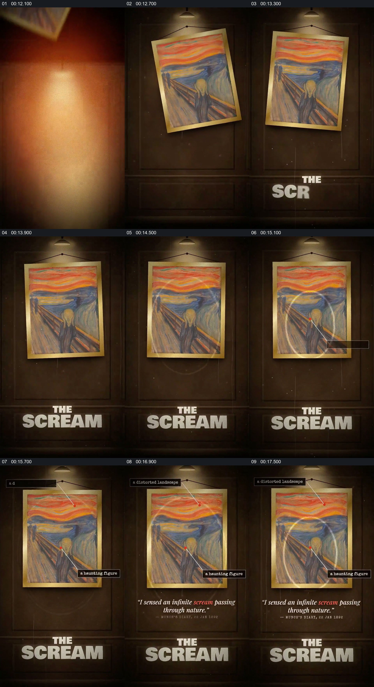

# 在画作原貌上同时展示局部标注和一句引文

- 作品：案例 126（原批次 S01）《呐喊背后的故事》；[公开来源](https://skillry.dev/ai-videos/fable5-2/osmanaga-146194)。
- 原片范围：00:12.000—00:18.100，源时间，含起点、不含终点；[本地来源视频](../video.mp4)｜[本卡片段](c01.mp4)。
- 范围依据：保留画框建立、作品名、局部提示与引文完整出现；随后切换为多个版本的另一场面。
- 观察方式与未确认范围：本轮查看整段来源的 64 帧时间序列及本卡九格，未独立完成连续原速观看；抽帧之间的连续运动、交叠、速度和停顿均待复核。本地视频有音轨，但本轮未完成听审。作品分析不等同于作者意图；迁移方法尚未在新项目实做。
- 原批次编号：S01-c01；正式编号：126-c01。

## 原画面具体怎样设计

一幅《呐喊》图像置于深色墙面和顶灯下，画框成为主要视觉中心；下方出现作品名。随后画面上出现白色圆形和连线，指向画中人物，另一个小标签位于画作上方，右下标签对应人物区域。

画作保持可辨认，画面下方逐渐出现一段引文，其中一词被标成红色。文字、标记与画框同时存在，到白色背景切换时本段结束。

## 为什么这样设计，好在哪里

作品分析：先让观众看整幅作品，再把标签落到具体位置，可以把解说中的抽象说法重新指回画面；作品名和引文位于画框外，避免完全遮挡主体。这里对引文、作者和版本的真实性没有独立查证，标签含义也只是原片呈现。

## 可直接使用的创意指令

选有清晰全貌与可靠出处的图像，先建立作品和观看位置，再用少量指向线或局部圈点揭示与本段叙述直接相关的细节；引文放在不会遮住关键画面的可读区域，并说明出处。保留整体作品作为参照，标签必须指向具体可见对象。展厅、画框和颜色可换；涉及版权、引文与版本时按真实来源处理。
