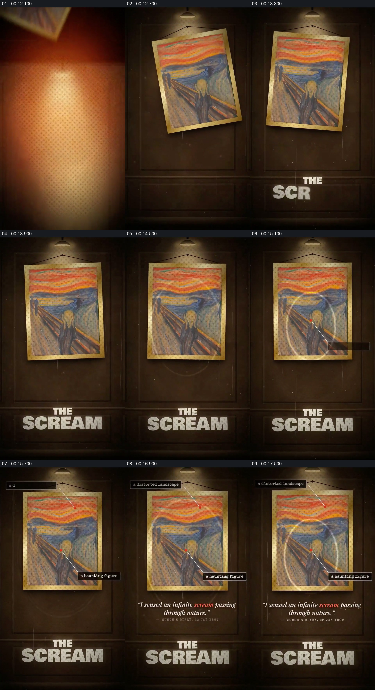

# 在画作原貌上同时展示局部标注和一句引文

- 作品：案例 126（原批次 S01）《呐喊背后的故事》；[公开来源](https://skillry.dev/ai-videos/fable5-2/osmanaga-146194)。
- 原片范围：00:12.000—00:18.100，源时间，含起点、不含终点；[本地来源视频](../video.mp4)｜[本卡片段](c01.mp4)。
- 范围依据：保留画框建立、作品名、局部提示与引文完整出现；随后切换为多个版本的另一场面。
- 观察方式与未确认范围：本轮查看整段来源的 64 帧时间序列及本卡九格，未独立完成连续原速观看；抽帧之间的连续运动、交叠、速度和停顿均待复核。本地视频有音轨，但本轮未完成听审。作品分析不等同于作者意图；迁移方法尚未在新项目实做。
- 原批次编号：S01-c01；正式编号：126-c01。

## 原画面具体怎样设计

一幅《呐喊》图像置于深色墙面和顶灯下，画框成为主要视觉中心；下方出现作品名。随后画面上出现白色圆形和连线，指向画中人物，另一个小标签位于画作上方，右下标签对应人物区域。

画作保持可辨认，画面下方逐渐出现一段引文，其中一词被标成红色。文字、标记与画框同时存在，到白色背景切换时本段结束。

## 为什么这样设计，好在哪里

作品分析：先让观众看整幅作品，再把标签落到具体位置，可以把解说中的抽象说法重新指回画面；作品名和引文位于画框外，避免完全遮挡主体。这里对引文、作者和版本的真实性没有独立查证，标签含义也只是原片呈现。

## 完整照排指令

以[完整原片](../video.mp4)的 12–18.1 秒为准。画幅 1080×1920，源帧率 30/1。以下拍点为抽帧定位，位置按画幅百分比取近似值。

### 源时刻照排

- 12–约 14 秒，画框从偏斜近景归正，深棕墙板在后，暖色【顶灯】投光于挂线和居中【画作图像】。底部用白色粗体两行【作品名称】，上行字号更小。
- 约 14–16 秒，画上增白色椭圆【人物圈选】，细线和红点各连【人物标签】及上方【景物标签】。暗底浅字小签靠对应画区，始终留可辨画框和画中人物。
- 约 16–18.1 秒，画框下方与作品名之间排米白色斜体【引文原句】，主词用红色，其下极小【引文出处】。已有标记留在画作上；18.1 秒切白底版本比较。

### 用料与取用

【画作图像】供具体版本和可核对的馆藏图，保留完整边缘，12–18.1 秒持续在同一墙面和框内，允许静态图配单次归正与入场，稳定后保持，不循环晃动。【顶灯】【人物圈选】【人物标签】【景物标签】单独分层，圈和引线标注可见位置，短签避免冒充作者原话。【作品名称】【引文原句】【引文出处】交原文及核对过的译文，注明作者、记录日期、版本、页码或馆藏链接；红词在原句中须可定位。仅有画作与画内标记可单用约 12–16 秒，删去无证引文。

### 验证状态

已对照原片密集抽帧与卡稿，核对画框归正、圈线落点、两层文字与白底切出。原速听看、精确帧与实际换料待核。
