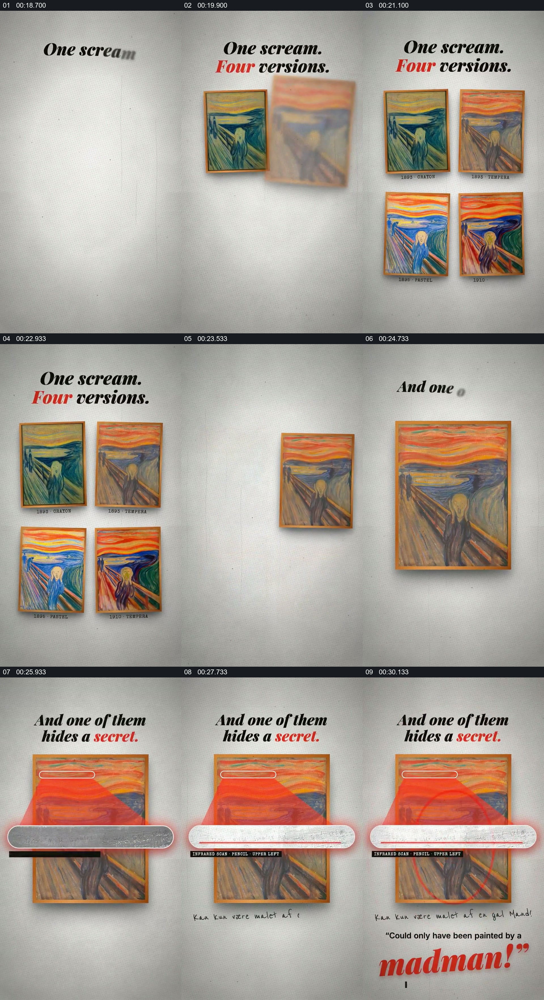

# 从同一作品的版本集合进入一处细节

- 作品：案例 126（原批次 S01）《呐喊背后的故事》；[公开来源](https://skillry.dev/ai-videos/fable5-2/osmanaga-146194)。
- 原片范围：00:18.100—00:32.000，源时间，含起点、不含终点；[本地来源视频](../video.mp4)｜[本卡片段](c02.mp4)。
- 范围依据：从四幅并列建立版本关系，到单幅接管、局部放大与文字说明形成结果；之后进入新的结尾。
- 观察方式与未确认范围：本轮查看整段来源的 64 帧时间序列及本卡九格，未独立完成连续原速观看；抽帧之间的连续运动、交叠、速度和停顿均待复核。本地视频有音轨，但本轮未完成听审。作品分析不等同于作者意图；迁移方法尚未在新项目实做。
- 原批次编号：S01-c02；正式编号：126-c02。

## 原画面具体怎样设计

白色墙面上方出现“一声呐喊、四个版本”的标题，四张相近但颜色不同的画作组成两行两列，各自下方有小字。随后画面只保留一幅橙色调作品，标题改成其中一幅藏着秘密。

画面在这幅画上标出上方小区域，一条横向放大带覆盖在画作中部并展示细长的文字局部；下方逐渐出现手写文字和英文引文，最后一个红色大词成为强调点。画作主体仍作为底层参照。

## 为什么这样设计，好在哪里

作品分析：版本集合先回答“同一题目有不同对象”，单幅放大才使观众知道接下来研究的是哪一件；局部放大带与画作同时保留，能把细节重新连回整体。引文是作品的叙述，未核验笔迹、文字归属或对应版本。

## 可直接使用的创意指令

需要比较多份有共同身份的材料时，先并列展示能辨别差异的版本及必要标识，再明确选定其中一份。让被研究的原件保留在画面中，用指向关系将实际局部移到足够清晰的阅读位置，最后呈现有出处的解释或引文。网格、色彩和放大带都可替换；不能丢失“集合—所选对象—该对象的真实细节”的关系。
