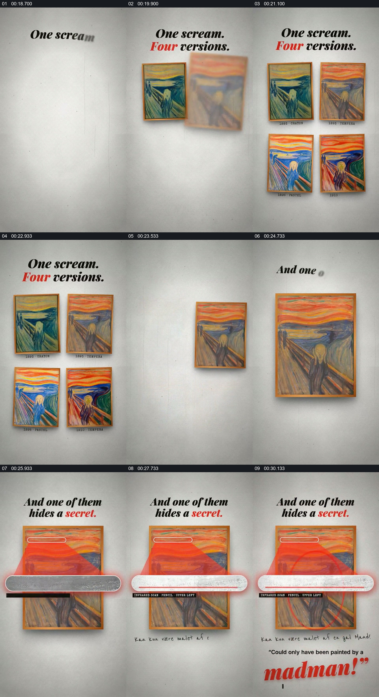

# 从同一作品的版本集合进入一处细节

- 作品：案例 126（原批次 S01）《呐喊背后的故事》；[公开来源](https://skillry.dev/ai-videos/fable5-2/osmanaga-146194)。
- 原片范围：00:18.100—00:32.000，源时间，含起点、不含终点；[本地来源视频](../video.mp4)｜[本卡片段](c02.mp4)。
- 范围依据：从四幅并列建立版本关系，到单幅接管、局部放大与文字说明形成结果；之后进入新的结尾。
- 观察方式与未确认范围：本轮查看整段来源的 64 帧时间序列及本卡九格，未独立完成连续原速观看；抽帧之间的连续运动、交叠、速度和停顿均待复核。本地视频有音轨，但本轮未完成听审。作品分析不等同于作者意图；迁移方法尚未在新项目实做。
- 原批次编号：S01-c02；正式编号：126-c02。

## 原画面具体怎样设计

白色墙面上方出现“一声呐喊、四个版本”的标题，四张相近但颜色不同的画作组成两行两列，各自下方有小字。随后画面只保留一幅橙色调作品，标题改成其中一幅藏着秘密。

画面在这幅画上标出上方小区域，一条横向放大带覆盖在画作中部并展示细长的文字局部；下方逐渐出现手写文字和英文引文，最后一个红色大词成为强调点。画作主体仍作为底层参照。

## 为什么这样设计，好在哪里

作品分析：版本集合先回答“同一题目有不同对象”，单幅放大才使观众知道接下来研究的是哪一件；局部放大带与画作同时保留，能把细节重新连回整体。引文是作品的叙述，未核验笔迹、文字归属或对应版本。

## 完整照排指令

以[完整原片](../video.mp4)的 18.1–32 秒为准。画幅 1080×1920，源帧率 30/1。以下拍点为抽帧定位，位置按画幅百分比取近似值。

### 源时刻照排

- 18.1–约 23 秒，浅灰白展墙上方居中排黑色粗斜体【版本标题】，关键数量词红色。下方四幅【版本图像】等高进入两行两列，每张底下放细小【版本标签】；统一留边，保持原作色彩差别。
- 约 23–27 秒，其余版本淡出，选中【刻字版本】原位突出后居中放大，上方换【发现标题】，重点词红色。细描边圈出画作上部【刻字定位区】，展开半透明红色投影连接横向【刻字放大带】；带下细黑条排【检测标签】。
- 约 27–32 秒，画作与定位层持续，底部先出现【手写原文】，再排黑色【引文译文】，末词用倾斜红色大字【强调词】落下，下面小字可放【出处短注】。保持能看到画、字带和原文后切出。

### 用料与取用

【版本图像】【版本标签】需明确每幅作品的年代、媒材、收藏方和可核对来源；【刻字版本】必须能在上述格内追溯，约 18.1–32 秒由同一版本的缩图转为单幅底图。供能对应精确画区的【刻字定位区】【刻字放大带】，带内图像须为该处实际局部，若用检测影像交原始公开记录和【检测标签】。照片可静置或单次放大，禁止把模拟读字结果当实际证据。交【版本标题】【发现标题】【手写原文】【引文译文】【强调词】【出处短注】及页码、馆藏编号或可打开的研究出处。只具备版本材料可独立用 18.1–约 23 秒；只有单幅及局部证据可用约 23–32 秒，入点直接给完整画面。

### 验证状态

已对照原片约逐秒抽帧与卡稿，核对四格到单幅、红色连结区、局部横带与底部引文同屏。文献字句、帧级切点、原速听看及实际换料待核。
