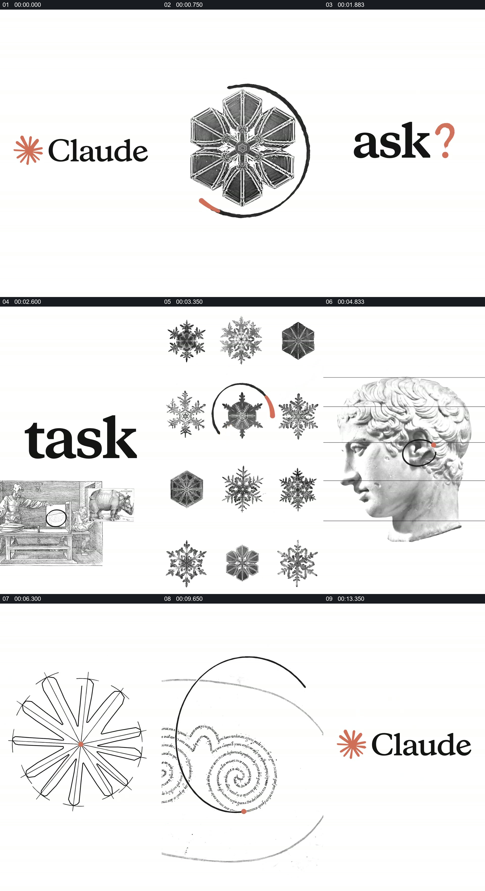

# 用同一视觉线索把版画、文字和品牌标志串成一组

- 作品：案例 127（原批次 S02）《版画与文字拼贴》；[公开来源](https://www.reclip.io/claude-opus-5-5-video-prompts/engraving-style-claude-ad)。
- 原片范围：00:00.000—00:14.528，源时间，含起点、不含终点；[本地来源视频](../video.mp4)｜[本卡片段](../video.mp4)。
- 范围依据：问句、版画片段、文字变化和品牌标志收束为同一条品牌表达；不把每个造型切换各自建卡。
- 观察方式与未确认范围：本轮查看整段来源的 40 帧时间序列及本卡九格，未独立完成连续原速观看；抽帧之间的连续运动、交叠、速度和停顿均待复核。本地视频有音轨，但本轮未完成听审。作品分析不等同于作者意图；迁移方法尚未在新项目实做。
- 原批次编号：S02-c01；正式编号：127-c01。

## 原画面具体怎样设计

白色背景上出现 Claude 标志，随后画面以黑色雕版风格的几何、人体、手、自然形态与衬线文字构成一组快速变化的画面。红橙色小点、弧线或花形在多个状态中反复出现。

“ask”“task”“draft”“craft”等词分别与不同物件或辅助线同画；后半段可见手、花、线框、植物、人体图和螺旋图案。结尾转为“Keep thinking.”，红橙花形回到品牌标志旁。

## 为什么这样设计，好在哪里

作品分析：图像内容各异，但近似黑白质感、留白以及重复的暖色记号，让这些片段能被当成同一视觉系统；文字在不同对象旁边提出动作，而不是只作为角落字幕。由于镜头变化快，具体变形路径与动作交叠仍待连续查看。

## 可直接使用的创意指令

围绕一个主题选择有共同视觉质感、但对象各不相同的资料，确定一个可以反复出现的小型视觉线索，使它在文字和图像之间承担回认作用。每个阶段让一组对象与一个具体动词建立关系，最后将线索回收到主题或身份标识。材料、记号和版式可以替换；保持统一线索与对象之间的明确关系，不必复制原片的暖色花形。
