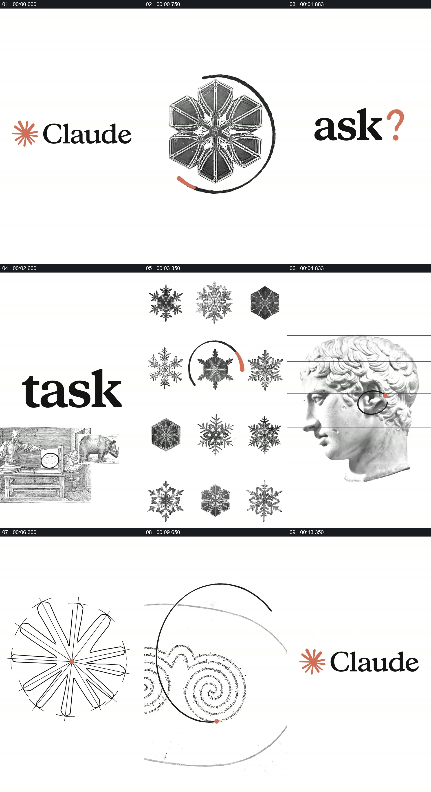

# 用同一视觉线索把版画、文字和品牌标志串成一组

- 作品：案例 127（原批次 S02）《版画与文字拼贴》；[公开来源](https://www.reclip.io/claude-opus-5-5-video-prompts/engraving-style-claude-ad)。
- 原片范围：00:00.000—00:14.528，源时间，含起点、不含终点；[本地来源视频](../video.mp4)｜[本卡片段](../video.mp4)。
- 范围依据：问句、版画片段、文字变化和品牌标志收束为同一条品牌表达；不把每个造型切换各自建卡。
- 观察方式与未确认范围：本轮查看整段来源的 40 帧时间序列及本卡九格，未独立完成连续原速观看；抽帧之间的连续运动、交叠、速度和停顿均待复核。本地视频有音轨，但本轮未完成听审。作品分析不等同于作者意图；迁移方法尚未在新项目实做。
- 原批次编号：S02-c01；正式编号：127-c01。

## 原画面具体怎样设计

白色背景上出现 Claude 标志，随后画面以黑色雕版风格的几何、人体、手、自然形态与衬线文字构成一组快速变化的画面。红橙色小点、弧线或花形在多个状态中反复出现。

“ask”“task”“draft”“craft”等词分别与不同物件或辅助线同画；后半段可见手、花、线框、植物、人体图和螺旋图案。结尾转为“Keep thinking.”，红橙花形回到品牌标志旁。

## 为什么这样设计，好在哪里

作品分析：图像内容各异，但近似黑白质感、留白以及重复的暖色记号，让这些片段能被当成同一视觉系统；文字在不同对象旁边提出动作，而不是只作为角落字幕。由于镜头变化快，具体变形路径与动作交叠仍待连续查看。

## 完整照排指令

以[完整原片](../video.mp4)的 0–14.528 秒为准。画幅 1080×1920，源帧率 60/1。以下拍点为抽帧定位，位置按画幅百分比取近似值。

### 源时刻照排

- 0–约 5 秒，近白满幅，品牌开场后让出中心，切【雕版图像】中的人体、几何及自然样本。以细黑弧线与橙红【识别点】指向局部；关键词用中央大号黑衬线【动词组】，局部字符以橙色强调。单图主位和网格式重复各留清楚边界。
- 约 5–10 秒，横向细行线托住【动词组】中的草稿词和橙色划痕，转入线描放射形、石像局部与散点连线。减少同时出现的元素，橙色落在线端、雕像局部或放射花形。
- 约 10–14.528 秒，黑色螺旋围着浅灰石像延展，抽离图像后留下小橙点及【收束短句】，末拍用放射【品牌符号】和黑色【品牌字样】合成居中横排，保持白底至片尾。

### 用料与取用

【雕版图像】交能按授权并列或居中裁切的黑白图组，优先留白清楚、线条可读。附真实档案或艺术作品的馆藏、作者及链接。【动词组】【收束短句】【品牌字样】交可大号独立排印的短文。【识别点】【品牌符号】使用同一橙红色和可对照的放射语言，开场至片尾分拍保留辨识点。图像可为静态并做单次运镜，线和点的动势须各自有入点与终点，禁止循环填长某拍。仅单图可独立用约 5–10 秒中的一个图文节拍，单有品牌组合可采用末段白底定版。

### 验证状态

已对照原片近逐秒抽帧与卡稿，核对雕版及衬线排字、橙点落位、螺旋与标志回收。快速切换精确帧、原速听看与试摆待核。
