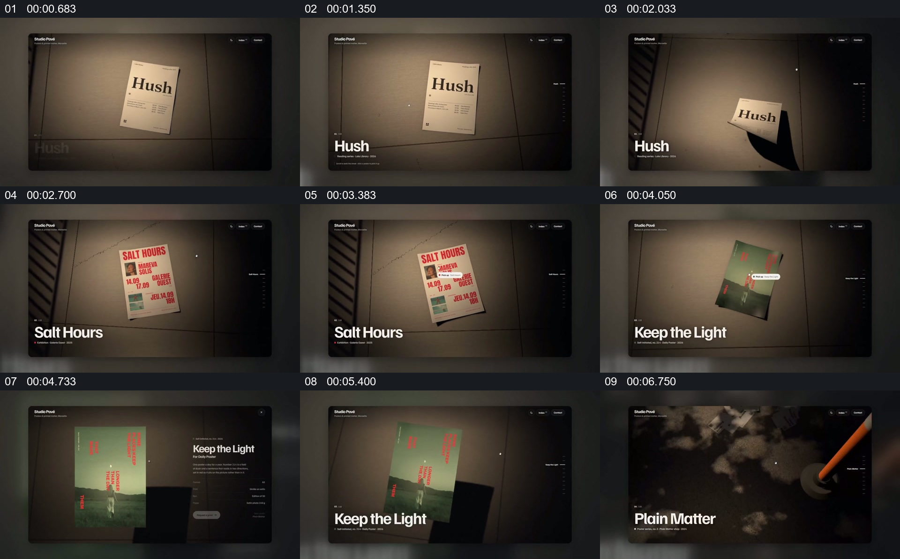

# 在同一展台上切换海报，并展开选中作品的说明

- 作品：案例 128（原批次 S03）《六组网站动效展示》；[公开来源](https://skillry.dev/ai-videos/fable5-2/maybeflorent-792255)。
- 原片范围：00:00.000—00:06.900，源时间，含起点、不含终点；[本地来源视频](../video.mp4)｜[本卡片段](c01.mp4)。
- 范围依据：从纸张作品在展台建立，到不同海报替换及其中一件的说明出现；之后进入另一种环形画廊。
- 观察方式与未确认范围：本轮查看整段来源的 64 帧时间序列及本卡九格，未独立完成连续原速观看；抽帧之间的连续运动、交叠、速度和停顿均待复核。本地视频无音轨。作品分析不等同于作者意图；迁移方法尚未在新项目实做。
- 原批次编号：S03-c01；正式编号：128-c01。

## 原画面具体怎样设计

黑色界面内，一张纸质海报位于有光斑的灰褐色展台中央，下方显示作品名。不同海报在同一展示区域先后出现，背景保留相似的地面与侧边阴影。之后绿色作品占据中央，右侧出现标题及说明信息；画面结束前出现下一件深色作品。

海报始终是主要对象，说明放在旁边，作品与容器之间保留清楚的观看距离。具体翻页或替换的连续动作尚需复核。

## 为什么这样设计，好在哪里

作品分析：作品本身换掉而展示空间保持，观众可以将不同海报理解为同一作品集中的平级对象；选中一件后才出现详情，避免每件都同时堆叠文字。灯光和纸张只是原片采用的包装，核心在于稳定展位与详情的关系。

## 可直接使用的创意指令

把有明确身份的平面作品放入共同展位，先保留足够大的主体和名称，再按需要切换对象。需要进一步说明时，保持被选作品可见，在旁侧展开对应信息，结束后回到集合或交给下一件。材质、颜色与光线可重设；被选作品及其说明必须能够一一对应，不要用无法辨认的图片墙替代作品阅读。
