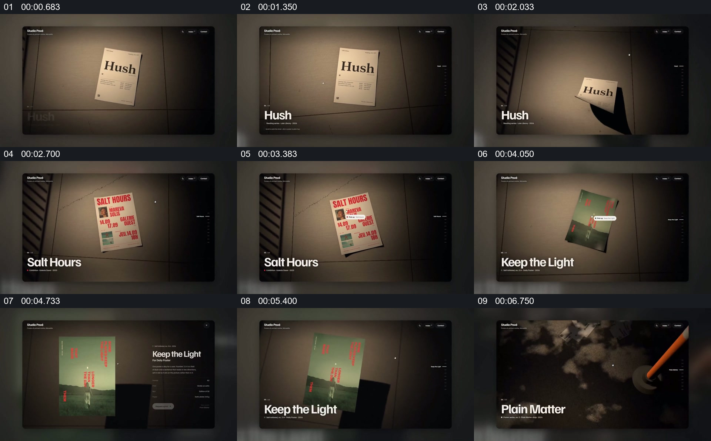

# 在同一展台上切换海报，并展开选中作品的说明

- 作品：案例 128（原批次 S03）《六组网站动效展示》；[公开来源](https://skillry.dev/ai-videos/fable5-2/maybeflorent-792255)。
- 原片范围：00:00.000—00:06.900，源时间，含起点、不含终点；[本地来源视频](../video.mp4)｜[本卡片段](c01.mp4)。
- 范围依据：从纸张作品在展台建立，到不同海报替换及其中一件的说明出现；之后进入另一种环形画廊。
- 观察方式与未确认范围：本轮查看整段来源的 64 帧时间序列及本卡九格，未独立完成连续原速观看；抽帧之间的连续运动、交叠、速度和停顿均待复核。本地视频无音轨。作品分析不等同于作者意图；迁移方法尚未在新项目实做。
- 原批次编号：S03-c01；正式编号：128-c01。

## 原画面具体怎样设计

黑色界面内，一张纸质海报位于有光斑的灰褐色展台中央，下方显示作品名。不同海报在同一展示区域先后出现，背景保留相似的地面与侧边阴影。之后绿色作品占据中央，右侧出现标题及说明信息；画面结束前出现下一件深色作品。

海报始终是主要对象，说明放在旁边，作品与容器之间保留清楚的观看距离。具体翻页或替换的连续动作尚需复核。

## 为什么这样设计，好在哪里

作品分析：作品本身换掉而展示空间保持，观众可以将不同海报理解为同一作品集中的平级对象；选中一件后才出现详情，避免每件都同时堆叠文字。灯光和纸张只是原片采用的包装，核心在于稳定展位与详情的关系。

## 完整照排指令

以[完整原片](../video.mp4)的 0–6.9 秒为准。画幅 1920×1080，源帧率 60/1。以下拍点为抽帧定位，位置按画幅百分比取近似值。

### 源时刻照排

- 0–约 2.3 秒，画面中暗色【展览窗口】亮起，暖灰展台以中心光斑与侧边阴影托住斜置【首张海报】；窗口左下白色粗体【作品名】和细小说明，海报主体保持中部留白。
- 约 2.3–4.8 秒，首张退出，红字图及绿色【后续海报】先后进入同一光斑；左下【作品名】随更换更新。短白胶囊【详情入口】叠到当前海报旁。
- 约 4.8–6.9 秒，绿色作品移到偏左并扩大，右侧深色区列白色【详情标题】、细小【详情说明】与浅按钮。回到展台后出现深色下一件作品，6.9 秒交给作品集合。

### 用料与取用

【首张海报】【后续海报】交可按同一版面尺寸布置的授权正面图与清晰细节，当件从进入持续到下一件接管，允许静图置入场景并作单次转角、移位，禁止循环翻页伪装后续作品。【展览窗口】需要展台、阴影、遮挡物和独立 UI 层，贯穿 0–6.9 秒。【作品名】【详情标题】【详情说明】【详情入口】须随对应作品绑定，展开的绿色作品沿用选中图与题名。只有一件作品可用开场展台的约 0–2.3 秒结构，若详情齐全可独立用约 4.8–6.9 秒内的展开拍并在详情退出时切走。

### 验证状态

已对照原片密集抽帧与卡稿，核查展台锚点、作品替换与右栏详情身份一致。连续替换动作、原速听看与试摆待核。
