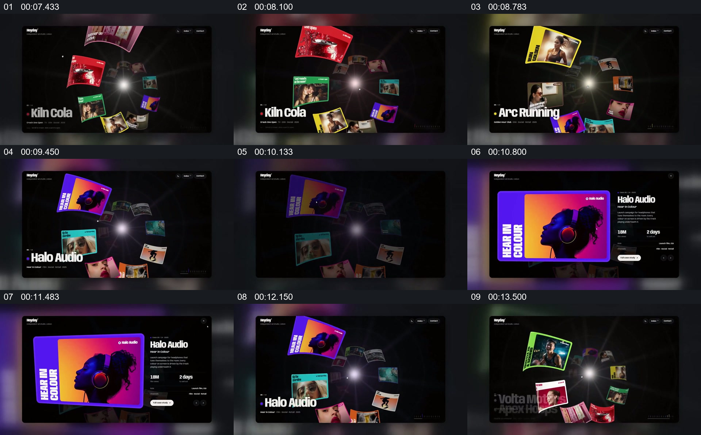

# 从放射状作品集合中选择一件，再回到集合

- 作品：案例 128（原批次 S03）《六组网站动效展示》；[公开来源](https://skillry.dev/ai-videos/fable5-2/maybeflorent-792255)。
- 原片范围：00:06.900—00:14.300，源时间，含起点、不含终点；[本地来源视频](../video.mp4)｜[本卡片段](c02.mp4)。
- 范围依据：从作品环形集合建立，到选中项目详情和回归集合；14 秒后转为书本页面。
- 观察方式与未确认范围：本轮查看整段来源的 64 帧时间序列及本卡九格，未独立完成连续原速观看；抽帧之间的连续运动、交叠、速度和停顿均待复核。本地视频无音轨。作品分析不等同于作者意图；迁移方法尚未在新项目实做。
- 原批次编号：S03-c02；正式编号：128-c02。

## 原画面具体怎样设计

暗色空间中，多张彩色作品围绕中央亮点向外分布，各画面保留独立的色彩与边界；左下角显示当前作品名。后续抽帧中，不同作品在集合中取得更显眼的位置，左下名称也随之改变。

选中紫橙色的 Halo Audio 后，作品被放大到左侧，右侧显示标题、说明和按钮；随后同一作品又回到周围仍有其他作品的集合中，左下标题继续对应当前选项。

## 为什么这样设计，好在哪里

作品分析：集合状态提供多样性和可选择性，详情状态则让观众看清一件作品；返回集合时周围作品作为持续参照，使局部不是凭空出现。抽帧不能证明各张卡片的运动路径或真实交互行为。

## 完整照排指令

以[完整原片](../video.mp4)的 6.9–14.3 秒为准。画幅 1920×1080，源帧率 60/1。以下拍点为抽帧定位，位置按画幅百分比取近似值。

### 源时刻照排

- 6.9–约 10.5 秒，深色作品窗保持边缘界面，中央白色【空间亮点】周围环布【作品卡组】，卡片有独立颜色、尺度及偏转，前侧主卡较大，后侧隐入暗处。左下白粗体【焦点作品名】随突出卡片更新。
- 约 10.5–12 秒，紫橙【选中作品】与同名标题接管。左侧将卡片放大并摆正，右侧深底栏以较粗【详情标题】、小号【详情内容】及白色【详情按钮】排列。窗口四周可带对应作品色光，文字避开主图。
- 约 12–14.3 秒，详情退回，选中作品以原身份回到卡组，随后下一个作品取得前景，左下名称继续更新；结束于集合浏览中。

### 用料与取用

【作品卡组】【选中作品】须同一作品集合，给每件可授权图、名称与稳定识别信息，选中图须在集合、详情与返回时保持同文件或有对应裁切。约 7–14.3 秒集合在详情前后保持位置和浏览方向可对读；卡用静态正面配三维排布与一次位移，若作品本身是视频，入详情与退回中保持该作品时间连续，供足长素材，禁止循环或定格代替动作。【空间亮点】【焦点作品名】【详情标题】【详情内容】【详情按钮】单独分层，对应同一选中身份。只具备多作品图可单用 6.9–约 10.5 秒；仅一件详情可用约 10.5–12 秒的图文布局，不接缺素材的回集合。

### 验证状态

已对照原片密集抽帧与卡稿，核查左下名称、选中作品放大及同作品返回。精确展开帧、原速听看和实际换料待核。
