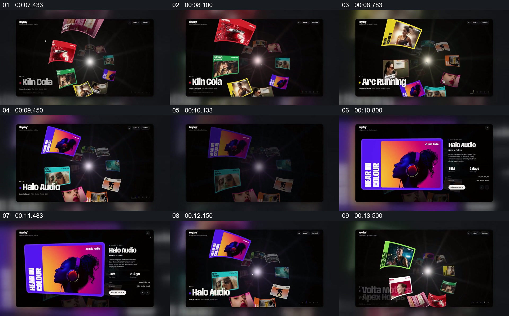

# 从放射状作品集合中选择一件，再回到集合

- 作品：案例 128（原批次 S03）《六组网站动效展示》；[公开来源](https://skillry.dev/ai-videos/fable5-2/maybeflorent-792255)。
- 原片范围：00:06.900—00:14.300，源时间，含起点、不含终点；[本地来源视频](../video.mp4)｜[本卡片段](c02.mp4)。
- 范围依据：从作品环形集合建立，到选中项目详情和回归集合；14 秒后转为书本页面。
- 观察方式与未确认范围：本轮查看整段来源的 64 帧时间序列及本卡九格，未独立完成连续原速观看；抽帧之间的连续运动、交叠、速度和停顿均待复核。本地视频无音轨。作品分析不等同于作者意图；迁移方法尚未在新项目实做。
- 原批次编号：S03-c02；正式编号：128-c02。

## 原画面具体怎样设计

暗色空间中，多张彩色作品围绕中央亮点向外分布，各画面保留独立的色彩与边界；左下角显示当前作品名。后续抽帧中，不同作品在集合中取得更显眼的位置，左下名称也随之改变。

选中紫橙色的 Halo Audio 后，作品被放大到左侧，右侧显示标题、说明和按钮；随后同一作品又回到周围仍有其他作品的集合中，左下标题继续对应当前选项。

## 为什么这样设计，好在哪里

作品分析：集合状态提供多样性和可选择性，详情状态则让观众看清一件作品；返回集合时周围作品作为持续参照，使局部不是凭空出现。抽帧不能证明各张卡片的运动路径或真实交互行为。

## 可直接使用的创意指令

先把各份作品布置在同一空间，保证每件仍可区分；以名称、大小或位置明确当前焦点。展开焦点时保留它的可辨认内容，将对应文字安排在邻近区域；结束后让集合重新成为参照。可换成平面网格、时间线或其他容器，关键是保留“集合—选中作品—该作品说明—集合”的身份连续。
