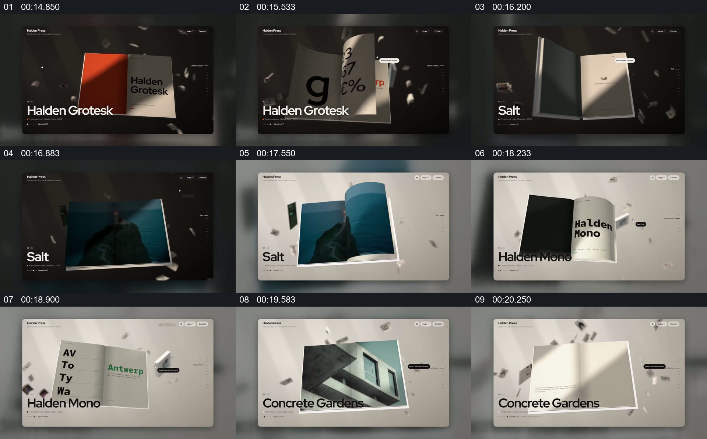

# 让书页本身承担作品浏览与详情展示

- 作品：案例 128（原批次 S03）《六组网站动效展示》；[公开来源](https://skillry.dev/ai-videos/fable5-2/maybeflorent-792255)。
- 原片范围：00:14.300—00:21.000，源时间，含起点、不含终点；[本地来源视频](../video.mp4)｜[本卡片段](c03.mp4)。
- 范围依据：从深色书本展开到浅色空间里的多份页面示例，之后切换到网格隧道。
- 观察方式与未确认范围：本轮查看整段来源的 64 帧时间序列及本卡九格，未独立完成连续原速观看；抽帧之间的连续运动、交叠、速度和停顿均待复核。本地视频无音轨。作品分析不等同于作者意图；迁移方法尚未在新项目实做。
- 原批次编号：S03-c03；正式编号：128-c03。

## 原画面具体怎样设计

深色空间中央出现打开的书本，两页分别承载文字和图像；随后的抽帧中页面内容由字母图形换成黑色、蓝色及摄影页面。白色空间接替深色背景，但书页仍作为主要展示对象，旁边保留小型说明。

后续书页展示不同的字形和建筑图像，页面与周围漂浮的小形状保持在同一界面中。没有逐帧核对真实的翻页时序。

## 为什么这样设计，好在哪里

作品分析：将内容放在可识别的书页上，让每次更换具有共同的物理承载；页面展开既显示单张图，也展示版面与书脊的关系。明暗场景变化可区分展示阶段，但不应据此认定页面经过真实拍摄。

## 可直接使用的创意指令

如果原材料确有页面或多页结构，先建立一本可辨认的载体，再在同一开页位置呈现图文，选择若干有差异的页面作为浏览对象；补充说明放在页外。最后停在可以阅读完整版面的状态。载体可以是册页、资料夹或折页，但应保留对象的页面关系和可读尺度，而不是只让封面反复飞入。
