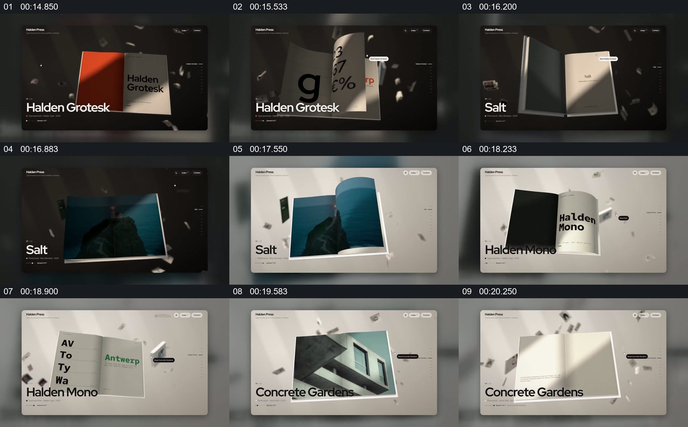

# 让书页本身承担作品浏览与详情展示

- 作品：案例 128（原批次 S03）《六组网站动效展示》；[公开来源](https://skillry.dev/ai-videos/fable5-2/maybeflorent-792255)。
- 原片范围：00:14.300—00:21.000，源时间，含起点、不含终点；[本地来源视频](../video.mp4)｜[本卡片段](c03.mp4)。
- 范围依据：从深色书本展开到浅色空间里的多份页面示例，之后切换到网格隧道。
- 观察方式与未确认范围：本轮查看整段来源的 64 帧时间序列及本卡九格，未独立完成连续原速观看；抽帧之间的连续运动、交叠、速度和停顿均待复核。本地视频无音轨。作品分析不等同于作者意图；迁移方法尚未在新项目实做。
- 原批次编号：S03-c03；正式编号：128-c03。

## 原画面具体怎样设计

深色空间中央出现打开的书本，两页分别承载文字和图像；随后的抽帧中页面内容由字母图形换成黑色、蓝色及摄影页面。白色空间接替深色背景，但书页仍作为主要展示对象，旁边保留小型说明。

后续书页展示不同的字形和建筑图像，页面与周围漂浮的小形状保持在同一界面中。没有逐帧核对真实的翻页时序。

## 为什么这样设计，好在哪里

作品分析：将内容放在可识别的书页上，让每次更换具有共同的物理承载；页面展开既显示单张图，也展示版面与书脊的关系。明暗场景变化可区分展示阶段，但不应据此认定页面经过真实拍摄。

## 完整照排指令

以[完整原片](../video.mp4)的 14.3–21 秒为准。画幅 1920×1080，源帧率 60/1。以下拍点为抽帧定位，位置按画幅百分比取近似值。

### 源时刻照排

- 14.3–约 17 秒，暗色展览窗中，居中斜置展开的【书本模型】，打开的左右页分放【跨页样张】。前景书页卷过中缝逐步遮住旧页，落稳露出下一组。左下白色【作品名称】随换书同步更新，右侧小胶囊【查看入口】避开页缘。
- 约 17–19 秒，展览窗切浅白背景，保留书轴、页边及其阴影，左下名称换黑字。蓝色摄影页、黑色封面与字体样张先后占据同一主位，漂浮【纸片装饰】比书小且尽量不盖字。
- 约 19–21 秒，继续翻至建筑图像及后续字体书，右侧保留控件，书页处在换页状态时交给下一组展览通道。

### 用料与取用

【书本模型】须可分开封面、页纸、书脊和投影，在 14.3–21 秒保持统一观察角度和中缝位置；不同实体书可换装帧，但暗浅两套界面要能用相同摆位。交每种内容的【跨页样张】完整左右页、裁切余量和可核对的【作品名称】，使字形、摄影或建筑页对得上真实作品。静态版面可贴在可形变的纸面，翻页要有卷曲、遮挡与落位，禁止循环重翻或以平移照片代替。装饰和【查看入口】可用固定图层。仅有一组样张时可单取暗色约 14.3–17 秒或浅色约 17–19 秒中的一次完整翻页，在新页读清时切出。

### 验证状态

已对照原片密集抽帧与卡稿，核查书页主位、深浅场景更换、图文样张和左下作品名。翻页确切帧、原速听看与换料试摆待核。
