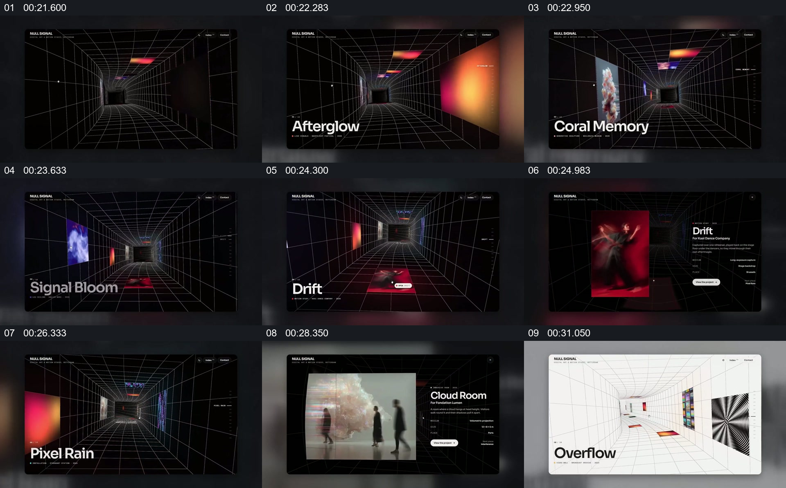

# 在有透视的画廊空间里选中作品并展开详情

- 作品：案例 128（原批次 S03）《六组网站动效展示》；[公开来源](https://skillry.dev/ai-videos/fable5-2/maybeflorent-792255)。
- 原片范围：00:21.000—00:33.000，源时间，含起点、不含终点；[本地来源视频](../video.mp4)｜[本卡片段](c04.mp4)。
- 范围依据：网格空间建立、作品分布、单件详情以及返回同类空间构成一组展示；后续切到产品货架。
- 观察方式与未确认范围：本轮查看整段来源的 64 帧时间序列及本卡九格，未独立完成连续原速观看；抽帧之间的连续运动、交叠、速度和停顿均待复核。本地视频无音轨。作品分析不等同于作者意图；迁移方法尚未在新项目实做。
- 原批次编号：S03-c04；正式编号：128-c04。

## 原画面具体怎样设计

黑色透视网格构成一条向中心收拢的通道，彩色矩形作品分布在侧面和顶部，左下方显示作品名。不同抽帧中，靠近前景的作品与文字名称发生变化，背景网格始终保留纵深。

某一作品被放大到左侧，右侧显示名称、说明和按钮；之后画面再次回到可见多件作品的通道，随后同类结构切换为白色背景。

## 为什么这样设计，好在哪里

作品分析：透视网格给彼此独立的图片一个共同空间；始终可见的空间边线帮助观众理解作品的相对位置。被选中后作品和文字并排，能从巡览转向阅读。不能仅凭静帧声称相机在真实三维空间中连续运动。

## 完整照排指令

以[完整原片](../video.mp4)的 21–33 秒为准。画幅 1920×1080，源帧率 60/1。以下拍点为抽帧定位，位置按画幅百分比取近似值。

### 源时刻照排

- 21–约 25 秒，暗底【通道网格】从四侧向中央消失点收拢，彩色【通道作品】挂在左右、顶面及地面。前景作品放大经过侧边，左下以白色粗无衬线【焦点名称】标出当前项，细 UI 退到边缘。
- 约 25–29 秒，选中【详情主图】脱离墙面，在左侧放大，右侧黑底逐行组织白色【详情标题】、次级【项目说明】与白色【详情按钮】。退回通道后换另一件焦点，可再次短暂展开同样的左右详情构图。
- 约 29–33 秒，回到多件作品的网格通道，接着将底及网格改为白灰，左下名称变黑，保留消失点和悬挂逻辑，33 秒交给瓶罐陈列。

### 用料与取用

【通道网格】【通道作品】交同一纵深坐标和不同平面的作品图，深浅版本从 21 秒至 33 秒保持可对应的通道结构；交可定位的相机路径，禁止平面照片运镜替代近远遮挡或循环穿行填时。【详情主图】来自同一通道焦点，约 25–29 秒的每次展开使用同图、同题名，返回后能在同一位置认出作品。静态作品可贴图位移；若画内作品动态，提供至少覆盖进详情并返回的素材，保持播放连续，不定格。供【焦点名称】【详情标题】【项目说明】【详情按钮】及同一项目条目。仅有多图可取约 21–25 秒通道浏览；仅有单图及说明可取约 25–29 秒内一次详情稳定拍。

### 验证状态

已对照原片等距抽帧与卡稿，核查消失点、焦点名与放大作品的对应及深浅通道交接。进入详情的准确切点、原速听看和换料试摆待核。
