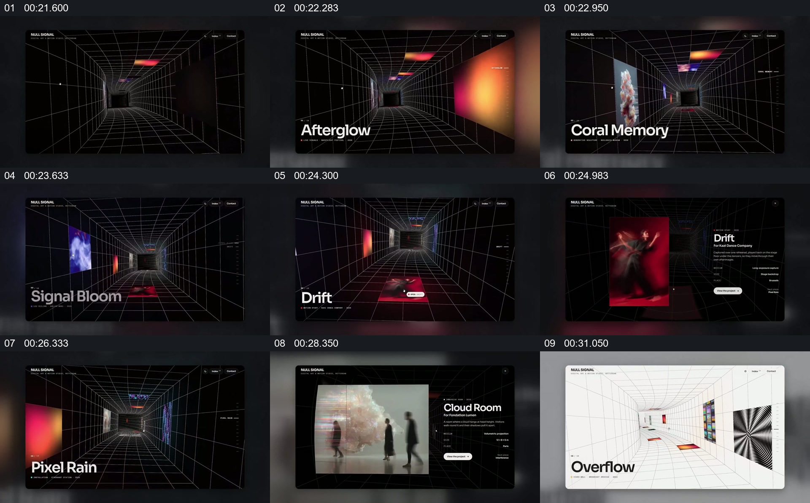

# 在有透视的画廊空间里选中作品并展开详情

- 作品：案例 128（原批次 S03）《六组网站动效展示》；[公开来源](https://skillry.dev/ai-videos/fable5-2/maybeflorent-792255)。
- 原片范围：00:21.000—00:33.000，源时间，含起点、不含终点；[本地来源视频](../video.mp4)｜[本卡片段](c04.mp4)。
- 范围依据：网格空间建立、作品分布、单件详情以及返回同类空间构成一组展示；后续切到产品货架。
- 观察方式与未确认范围：本轮查看整段来源的 64 帧时间序列及本卡九格，未独立完成连续原速观看；抽帧之间的连续运动、交叠、速度和停顿均待复核。本地视频无音轨。作品分析不等同于作者意图；迁移方法尚未在新项目实做。
- 原批次编号：S03-c04；正式编号：128-c04。

## 原画面具体怎样设计

黑色透视网格构成一条向中心收拢的通道，彩色矩形作品分布在侧面和顶部，左下方显示作品名。不同抽帧中，靠近前景的作品与文字名称发生变化，背景网格始终保留纵深。

某一作品被放大到左侧，右侧显示名称、说明和按钮；之后画面再次回到可见多件作品的通道，随后同类结构切换为白色背景。

## 为什么这样设计，好在哪里

作品分析：透视网格给彼此独立的图片一个共同空间；始终可见的空间边线帮助观众理解作品的相对位置。被选中后作品和文字并排，能从巡览转向阅读。不能仅凭静帧声称相机在真实三维空间中连续运动。

## 可直接使用的创意指令

准备多个相互独立的作品，以透视线、墙面或其他能辨认远近的载体组织空间；用大小和标签指示当前关注项。需要介绍某一件时，让它获得足够大的展示区并关联对应资料，随后保留或恢复整体空间作为参照。空间形态与作品数量可变，但每件作品应保留可识别身份，纵深装饰不应遮住实际内容。
