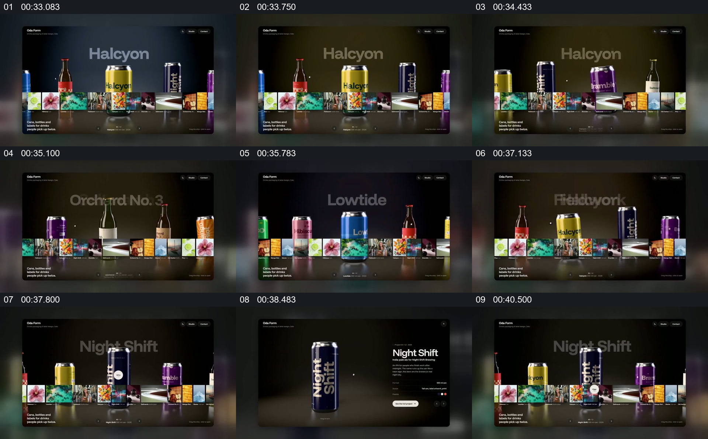

# 在产品集合里固定一个展位，再展开单品

- 作品：案例 128（原批次 S03）《六组网站动效展示》；[公开来源](https://skillry.dev/ai-videos/fable5-2/maybeflorent-792255)。
- 原片范围：00:33.000—00:42.533，源时间，含起点、不含终点；[本地来源视频](../video.mp4)｜[本卡片段](c05.mp4)。
- 范围依据：从多款饮料陈列、焦点产品变化到单品资料页及返回陈列；本地源文件在下一组状态中结束。
- 观察方式与未确认范围：本轮查看整段来源的 64 帧时间序列及本卡九格，未独立完成连续原速观看；抽帧之间的连续运动、交叠、速度和停顿均待复核。本地视频无音轨。作品分析不等同于作者意图；迁移方法尚未在新项目实做。
- 原批次编号：S03-c05；正式编号：128-c05。

## 原画面具体怎样设计

同一货架上并排放着不同颜色的瓶罐，底部还有一条由小图组成的横带；后景大字显示当前产品名称。随后不同款式出现在中央位置，名称及背景颜色也随之改变。

选中深蓝色罐体时，单个产品在深色背景左侧被放大，右侧出现产品名和说明；之后回到多款并列的货架。末尾仍有另一款陈列状态，源文件在这里结束。

## 为什么这样设计，好在哪里

作品分析：统一货架和前景小图让不同口味属于同一集合，中心位置和背景字则承担当前选择；单品页保留产品主体并为说明让出空间。产品外观与口味介绍只是示例界面，未核对产品真实性。

## 可直接使用的创意指令

将真实且可区分的同类产品放在共同陈列位置，先建立产品之间的并列关系，再以固定焦点位和名称明确当前对象。展开时放大被选产品并给对应说明留出阅读区，结束后回到集合。货架、色彩和产品数量可换；保持产品身份、标题与说明相对应，避免把不同产品的文案套在同一图片上。
