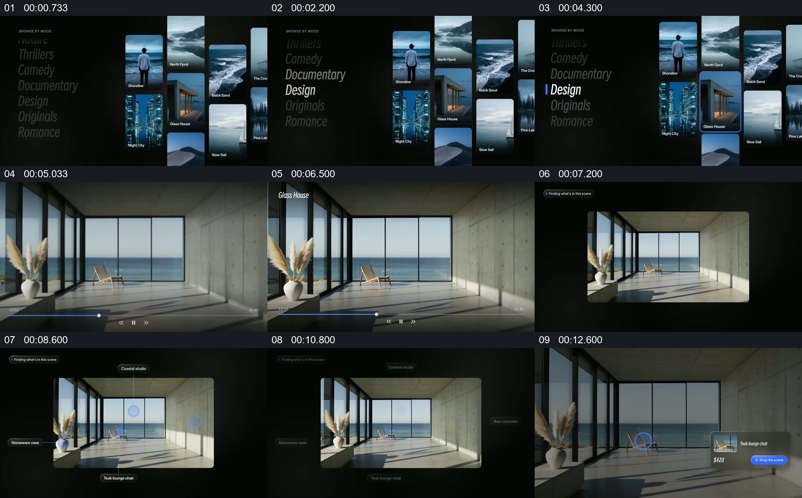

# 从图片浏览进入一张画面，再在画内定位对象

- 作品：案例 129（原批次 S04）《从图片列表进入画面》；[公开来源](https://skillry.dev/skills/bs-launchmotion-ui-genre-browse-zooms)。
- 原片范围：00:00.000—00:14.000，源时间，含起点、不含终点；[本地来源视频](../video.mp4)｜[本卡片段](../video.mp4)。
- 范围依据：分类列表、选中建筑画面、画内标记和单一对象信息构成一个完整浏览过程。
- 观察方式与未确认范围：本轮查看整段来源的 40 帧时间序列及本卡九格，未独立完成连续原速观看；抽帧之间的连续运动、交叠、速度和停顿均待复核。本地视频无音轨。作品分析不等同于作者意图；迁移方法尚未在新项目实做。
- 原批次编号：S04-c01；正式编号：129-c01。

## 原画面具体怎样设计

深色背景左侧是分类列表，右侧是多列窄幅图片；分类中 Design 被强调。随后右侧一张玻璃房屋图片在抽帧中变大，进入近乎满画幅的浏览画面，底部可见播放控件。

同一房屋画面缩回深色背景中央，多个圆形点落在窗、椅子和室内不同位置，周围出现对应的小标签。之后房屋重新变大，椅子附近保留圈点，旁边出现对象缩略图、名称和价格按钮。

## 为什么这样设计，好在哪里

作品分析：集合先提供选择上下文，房屋接管画面后，观众才有足够空间辨认室内对象；多个点先说明画面内有不同可查看位置，随后只保留一个具体对象的详情。这里的价格和控件是作品展示，无法由画面判断是否真的可交互。

## 完整照排指令

以[完整原片](../video.mp4)的 0–14 秒为准。画幅 1920×1080，源帧率 30/1。以下拍点为抽帧定位，位置按画幅百分比取近似值。

### 源时刻照排

- 0–约 4.5 秒，黑底左列细长无衬线【分类名】，当前类别白亮，其余退成灰。右侧不同高度的竖幅【浏览缩略图】列阵。选中图向外扩大，以玻璃窗框和水平海面转接【房屋主画面】。
- 约 4.5–8 秒，房屋近满幅，横向窗框和前景地面留出稳定定位，底缘显示【播放控件】。随后房屋缩入黑底中央的圆角宽框，周围留边给标注。
- 约 8–11 秒，依次在窗、座椅等对象上建【对象点位】，向外排小号【对象标签】，圈的中心跟随原图对象；先建立的点随着新点出现仍保留。
- 约 11–14 秒，同一房屋再次扩大并适度压暗，保留座椅圈点。其旁依次显示【商品缩略图】【商品名称】【价格按钮】，底部控件不压对象信息，14 秒切出。

### 用料与取用

【浏览缩略图】中的选中项及【房屋主画面】必须是同一空间及可匹配视角，约 4.5–14 秒的满幅、缩窗、回放大共用底图和对象坐标。若使用实播，交足长片段并保持播放连续，禁循环或定格；仅做静态图像浏览时，允许同照片缩放，控件须表达静态浏览。【对象点位】【对象标签】【商品缩略图】【商品名称】【价格按钮】来自同一可核对对象，提供对应图中位置、来源链接、币种与价格日期。【分类名】【播放控件】提供真实标签和界面状态。只有长画面和一处对象时可用约 11–14 秒单点详情，无关标记不进入。只有分类和预览图时可独立用 0–约 4.5 秒。

### 验证状态

已对照原片密集抽帧与卡稿，核查窗框位置、同场缩放、点位及座椅详情。原速听看、窗口播放相位和实际试摆待核。
