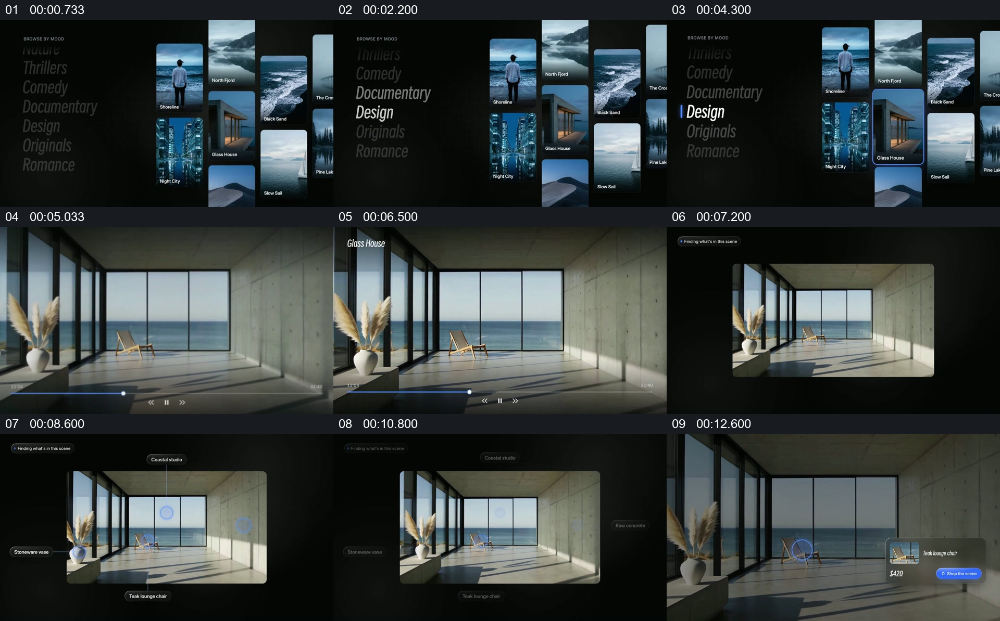

# 从图片浏览进入一张画面，再在画内定位对象

- 作品：案例 129（原批次 S04）《从图片列表进入画面》；[公开来源](https://skillry.dev/skills/bs-launchmotion-ui-genre-browse-zooms)。
- 原片范围：00:00.000—00:14.000，源时间，含起点、不含终点；[本地来源视频](../video.mp4)｜[本卡片段](../video.mp4)。
- 范围依据：分类列表、选中建筑画面、画内标记和单一对象信息构成一个完整浏览过程。
- 观察方式与未确认范围：本轮查看整段来源的 40 帧时间序列及本卡九格，未独立完成连续原速观看；抽帧之间的连续运动、交叠、速度和停顿均待复核。本地视频无音轨。作品分析不等同于作者意图；迁移方法尚未在新项目实做。
- 原批次编号：S04-c01；正式编号：129-c01。

## 原画面具体怎样设计

深色背景左侧是分类列表，右侧是多列窄幅图片；分类中 Design 被强调。随后右侧一张玻璃房屋图片在抽帧中变大，进入近乎满画幅的浏览画面，底部可见播放控件。

同一房屋画面缩回深色背景中央，多个圆形点落在窗、椅子和室内不同位置，周围出现对应的小标签。之后房屋重新变大，椅子附近保留圈点，旁边出现对象缩略图、名称和价格按钮。

## 为什么这样设计，好在哪里

作品分析：集合先提供选择上下文，房屋接管画面后，观众才有足够空间辨认室内对象；多个点先说明画面内有不同可查看位置，随后只保留一个具体对象的详情。这里的价格和控件是作品展示，无法由画面判断是否真的可交互。

## 可直接使用的创意指令

从有可见主体的图片或视频集合开始，明确一个选择对象；让该对象扩大到足以看清内容后，再将标记放在真实对象附近。若要解释其中某个细节，保留原图作为空间参照，收束其他提示并在邻近位置显示对应说明。可更换分类、界面和标记形式；不要让标签离开所指对象，或将演示按钮当成已实现功能。
