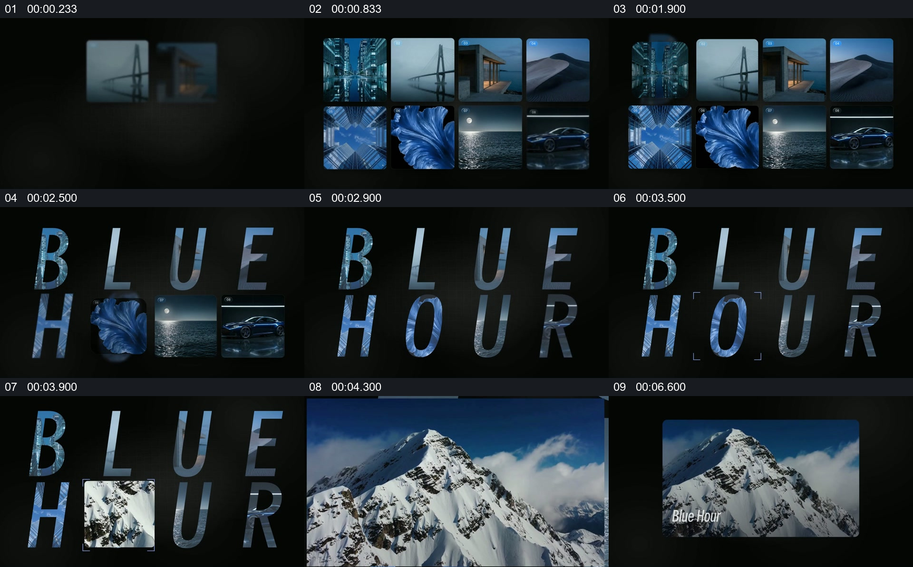

# 把图片集合重组成标题，再让一张图片接管

- 作品：案例 131（原批次 S06）《图片墙转标题》；[公开来源](https://skillry.dev/skills/bs-launchmotion-reveal-anatomy-panels-resolve)。
- 原片范围：00:00.000—00:08.000，源时间，含起点、不含终点；[本地来源视频](../video.mp4)｜[本卡片段](../video.mp4)。
- 范围依据：从图片墙、图片纹理文字到雪山代表画面和卡片收尾，完成一次集合到单一主体的聚焦。
- 观察方式与未确认范围：本轮查看整段来源的 40 帧时间序列及本卡九格，未独立完成连续原速观看；抽帧之间的连续运动、交叠、速度和停顿均待复核。本地视频无音轨。作品分析不等同于作者意图；迁移方法尚未在新项目实做。
- 原批次编号：S06-c01；正式编号：131-c01。

## 原画面具体怎样设计

黑色背景上陆续出现两行蓝色系图片，包括城市、桥、花、海和汽车。随后部分图片所占位置出现带有图像纹理的大写字母，组合成两行“BLUE HOUR”；仍有少量图片与字母同时存在。

一张雪山图随后出现在字母前方，扩大为主要画面，中央出现同名文字；最后雪山与标题缩回深色背景中的横向卡片。

## 为什么这样设计，好在哪里

作品分析：集合提供多种同一视觉主题的证据，大字从集合占据的区域形成，主题名称因而与图片有直接关系；雪山成为新的主画面，让观众从“很多例子”转向可停留的一张。图片是否逐张准确变形为对应字母需动态复核。

## 完整照排指令

以[完整原片](../video.mp4)的 0–8 秒为准。画幅 1920×1080，源帧率 30/1。以下拍点为抽帧定位，位置按画幅百分比取近似值。

### 源时刻照排

- 0–约 2 秒，近黑底上把冷蓝【图像组】依次铺入两行四列，等间距留黑。留意每格的亮部和主题不要在缩小后糊成一片。
- 约 2–4 秒，按原网格各位置逐步把矩形改为【标题字形遮罩】，宽距粗斜体上 四、下四个字位组成两行【主标题】；字内部延续图像纹理，未换格的矩形可短暂与字同屏。
- 约 4–6 秒，横向【雪山画面】从前景遮住部分字形，放大至近满幅，主峰偏左。中部白色窄斜体【同名小标题】不遮峰顶关键轮廓。
- 约 6–8 秒，同一山景缩为黑底中央的圆角横卡，标题移到卡中左下，原片结束时保留卡片与留白。

### 用料与取用

【图像组】需有八格短图及素材与字位映射，【标题字形遮罩】【主标题】选可按两行占格的词，给可读遮罩与蓝黑色外背景。各格约 0–4 秒持续，从缩图变字形时使用同一底纹与位置；静图允许作遮罩和一次运镜，动态则保持切前切后同进度并备足时长，禁循环或用定格代替轨迹。【雪山画面】约 4 秒出现、至 8 秒随卡持续，同一图像贯穿放大与缩回，【同名小标题】和【主标题】字义一致。仅有多图与字可用 0–4 秒，单有山景可单用约 4–8 秒的图卡转换，从可辨山景入。

### 验证状态

已对照原片密集抽帧与卡稿，核查图像格到字位、雪山盖住标题和缩卡保留内容。遮罩逐帧对应、原速听看与实际换料待核。
