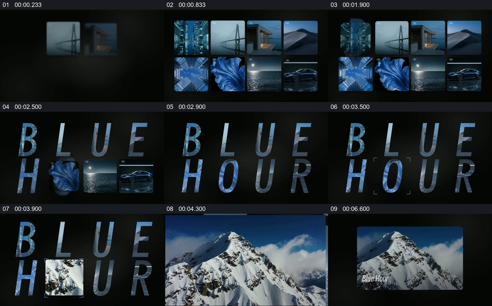

# 把图片集合重组成标题，再让一张图片接管

- 作品：案例 131（原批次 S06）《图片墙转标题》；[公开来源](https://skillry.dev/skills/bs-launchmotion-reveal-anatomy-panels-resolve)。
- 原片范围：00:00.000—00:08.000，源时间，含起点、不含终点；[本地来源视频](../video.mp4)｜[本卡片段](../video.mp4)。
- 范围依据：从图片墙、图片纹理文字到雪山代表画面和卡片收尾，完成一次集合到单一主体的聚焦。
- 观察方式与未确认范围：本轮查看整段来源的 40 帧时间序列及本卡九格，未独立完成连续原速观看；抽帧之间的连续运动、交叠、速度和停顿均待复核。本地视频无音轨。作品分析不等同于作者意图；迁移方法尚未在新项目实做。
- 原批次编号：S06-c01；正式编号：131-c01。

## 原画面具体怎样设计

黑色背景上陆续出现两行蓝色系图片，包括城市、桥、花、海和汽车。随后部分图片所占位置出现带有图像纹理的大写字母，组合成两行“BLUE HOUR”；仍有少量图片与字母同时存在。

一张雪山图随后出现在字母前方，扩大为主要画面，中央出现同名文字；最后雪山与标题缩回深色背景中的横向卡片。

## 为什么这样设计，好在哪里

作品分析：集合提供多种同一视觉主题的证据，大字从集合占据的区域形成，主题名称因而与图片有直接关系；雪山成为新的主画面，让观众从“很多例子”转向可停留的一张。图片是否逐张准确变形为对应字母需动态复核。

## 可直接使用的创意指令

先选择确有共同主题的一组素材，建立整齐可辨的集合；把主题名称放到集合原有的视觉位置，可用图像纹理或其他方式保留两者联系。再选一张最能承担后续内容的画面成为主体，并给予标题清楚的阅读时间。布局、字体、数量均可调整；保留集合、主题归纳和代表素材之间的关系。
