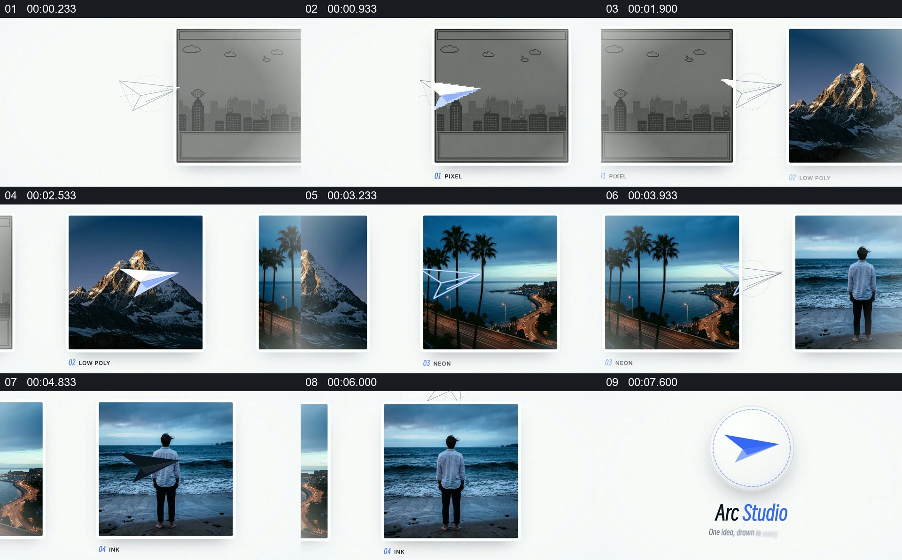

# 让同一个小对象穿过多张风格不同的画面

- 作品：案例 132（原批次 S07）《纸飞机连接画面》；[公开来源](https://skillry.dev/skills/bs-launchmotion-grid-pan-settles-embroidered)。
- 原片范围：00:00.000—00:09.000，源时间，含起点、不含终点；[本地来源视频](../video.mp4)｜[本卡片段](../video.mp4)。
- 范围依据：纸飞机穿过若干独立画面并收回成品牌图形；各图切换共同完成一次风格巡览。
- 观察方式与未确认范围：本轮查看整段来源的 40 帧时间序列及本卡九格，未独立完成连续原速观看；抽帧之间的连续运动、交叠、速度和停顿均待复核。本地视频无音轨。作品分析不等同于作者意图；迁移方法尚未在新项目实做。
- 原批次编号：S07-c01；正式编号：132-c01。

## 原画面具体怎样设计

白色背景中一张灰色像素城市画面位于中央，线描纸飞机从画面左侧靠近，之后出现白蓝色飞机形状。画面依次呈现山峰、海岸和海边人物等不同图片，每张图片下方带有小型风格标签，飞机形状反复出现在图像前方或边缘。

最后一张人物画面向下离开可视区域，白底中间保留蓝色纸飞机标志与工作室名称。抽帧只能确认对象在各状态中的位置，具体路径和跨画面连续性待复核。

## 为什么这样设计，好在哪里

作品分析：图片风格和内容不断变化，但重复出现的纸飞机为观众提供回认线索；最后将该形状用于品牌识别，使前面的巡览有一个统一出口。若只顺序切图而失去连接对象，作品之间的共同身份会减弱。

## 完整照排指令

以[完整原片](../video.mp4)的 0–9 秒为准。画幅 1920×1080，源帧率 30/1。以下拍点为抽帧定位，位置按画幅百分比取近似值。

### 源时刻照排

- 0–约 2 秒，白底居中偏上置方形【城市图】，下沿左对齐小号【风格标签】。细灰线描【纸飞机】由左向画面中央，经过图像边界时补白蓝色面，保持机头朝向可辨。
- 约 2–6.6 秒，等高【山峰图】【海岸图】【海边人物图】从侧边换入，交界短暂同屏。飞机在图前层横穿，白面和蓝面随姿态换向，在人物拍可压住肩部，但脸及轮廓留可辨空间。标签随各图保持在下缘。
- 约 6.6–9 秒，人物图与标签向下退出；白底上方留圆形浅边与影，中心同一纸飞机形转为蓝色【工作室图标】，下排黑蓝【工作室名称】和细小【副句】，终版留至片尾。

### 用料与取用

【城市图】【山峰图】【海岸图】【海边人物图】交可裁为同尺寸的图像和各自【风格标签】，主体避开飞机经过区。每图从入场到下张接管保持完整；静图可作单次滑移，若换成视频应交跨入出点的足长素材，避免循环或定格。自开场至约 6.6 秒使用同一个【纸飞机】轮廓，供线框、白蓝折面及正反面，以便跨图保持机头、翼尖与运动方向；口号拍使用同轮廓的【工作室图标】。供【工作室名称】【副句】及品牌样式。只有一张图时可独立取约 0–2 秒的线描飞入或约 5–6.6 秒人物一拍，在飞机通过后切出。

### 验证状态

已对照原片密集抽帧与卡稿，核对同一飞机跨图、标签锚点及人物图退出后的标志。精确航迹、各窗动作连续性、原速听看和试摆待核。
