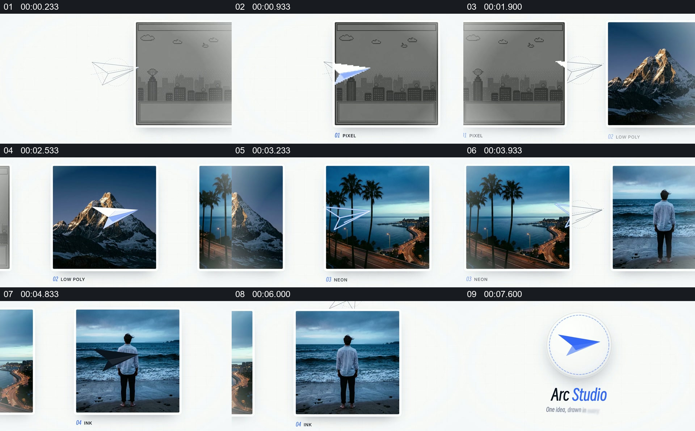

# 让同一个小对象穿过多张风格不同的画面

- 作品：案例 132（原批次 S07）《纸飞机连接画面》；[公开来源](https://skillry.dev/skills/bs-launchmotion-grid-pan-settles-embroidered)。
- 原片范围：00:00.000—00:09.000，源时间，含起点、不含终点；[本地来源视频](../video.mp4)｜[本卡片段](../video.mp4)。
- 范围依据：纸飞机穿过若干独立画面并收回成品牌图形；各图切换共同完成一次风格巡览。
- 观察方式与未确认范围：本轮查看整段来源的 40 帧时间序列及本卡九格，未独立完成连续原速观看；抽帧之间的连续运动、交叠、速度和停顿均待复核。本地视频无音轨。作品分析不等同于作者意图；迁移方法尚未在新项目实做。
- 原批次编号：S07-c01；正式编号：132-c01。

## 原画面具体怎样设计

白色背景中一张灰色像素城市画面位于中央，线描纸飞机从画面左侧靠近，之后出现白蓝色飞机形状。画面依次呈现山峰、海岸和海边人物等不同图片，每张图片下方带有小型风格标签，飞机形状反复出现在图像前方或边缘。

最后一张人物画面向下离开可视区域，白底中间保留蓝色纸飞机标志与工作室名称。抽帧只能确认对象在各状态中的位置，具体路径和跨画面连续性待复核。

## 为什么这样设计，好在哪里

作品分析：图片风格和内容不断变化，但重复出现的纸飞机为观众提供回认线索；最后将该形状用于品牌识别，使前面的巡览有一个统一出口。若只顺序切图而失去连接对象，作品之间的共同身份会减弱。

## 可直接使用的创意指令

选择若干能够体现同一主题不同侧面的图像，设计一个小而清晰的连接对象，让它在每幅图的可见区域中出现，并根据画面布局改变位置或材质。每张图保留足够辨认空间；结尾让连接对象承担标题或身份收束。飞机和风格标签均可换，需保持同一对象可以被认出，且不要暗示实际不存在的空间连续。
