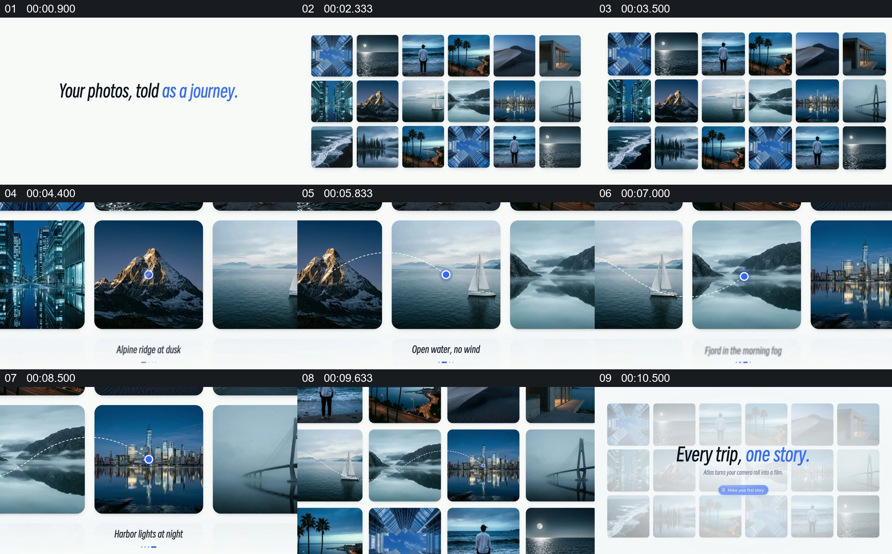

# 从图片墙中沿线定位几处，再回到整体

- 作品：案例 133（原批次 S08）《图片墙中移动和定位》；[公开来源](https://skillry.dev/skills/bs-launchmotion-grid-camera-pushes-petroglyph)。
- 原片范围：00:00.000—00:11.400，源时间，含起点、不含终点；[本地来源视频](../video.mp4)｜[本卡片段](../video.mp4)。
- 范围依据：从主题句和图片墙建立，到线与点指向多张图片，再回到集合及总结句。
- 观察方式与未确认范围：本轮查看整段来源的 40 帧时间序列及本卡九格，未独立完成连续原速观看；抽帧之间的连续运动、交叠、速度和停顿均待复核。本地视频无音轨。作品分析不等同于作者意图；迁移方法尚未在新项目实做。
- 原批次编号：S08-c01；正式编号：133-c01。

## 原画面具体怎样设计

白色背景先显示一行关于照片旅程的文字，右侧随后出现多行图片墙，内容包括建筑、雪山、帆船、城市与海面。图片墙在后续抽帧中变大，雪山图片附近出现蓝色圆点和一行小标题。

画面显示照片墙的其他相邻部分，蓝色圆点、细虚线和下方名称分别落到帆船、峡湾与城市等图片附近。最后视野重新包含多张图片，画面变淡，上面出现“Every trip, one story.”及按钮。

## 为什么这样设计，好在哪里

作品分析：图片墙先给出全集，之后在局部图像间定位，观众可以把每张照片当成同一行程中的一个点；细线和命名提供选择顺序，最后回到集合形成整体。不同照片是否确实属于同一次旅行不由视觉包装证明。

## 完整照排指令

以[完整原片](../video.mp4)的 0–11.4 秒为准。画幅 1920×1080，源帧率 30/1。以下拍点为抽帧定位，位置按画幅百分比取近似值。

### 源时刻照排

- 0–约 3.6 秒，浅白底中央先排黑色窄斜体【开场短句】，末段转蓝，右侧多行【旅程照片墙】出现并推近接管，图格蓝灰调、圆角、白缝等宽。标题淡出后照片墙占画。
- 约 3.6–9.2 秒，同一墙面平移，先把山峰图放在中部，蓝色【坐标点】落在图中、下方白地放同宽小号【地点标题】。沿细虚线查看帆船、峡湾、城市等相邻图，点与短标题依次更换，保持每张仍是原墙的一格。
- 约 9.2–11.4 秒，镜头拉回多图总览，前盖半透明白层，中央用黑蓝斜体【归纳短句】，下方细【副说明】和蓝色胶囊【入口按钮】，保留到片尾。

### 用料与取用

【旅程照片墙】应是同一旅程或有可说明顺序的一组图片，供平铺、裁切和图片至地点的映射。自约 2 秒建墙至 11.4 秒持续为同一集合，约 3.6–9.2 秒每张焦点图必须能在总览中找到，允许静态照片墙的一遍运镜，若交动态窗口须足长且保持可读位置，不循环。交【坐标点】【地点标题】的实际图中位置、短名及可核对地点资料；【开场短句】【归纳短句】【副说明】【入口按钮】供短排文字。只有若干照片及地名时可独立用约 3.6–9.2 秒的单次定位拍；只有完整墙但无地名可用约 9.2–11.4 秒收束。

### 验证状态

已对照原片密集抽帧与卡稿，核对同墙推近、相邻焦点、点与标题对应、总览恢复。准确运镜时序、原速听看及实际换料待核。
