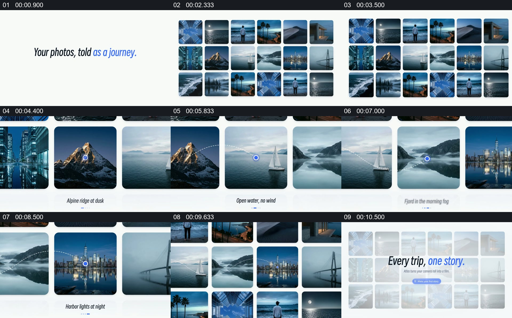

# 从图片墙中沿线定位几处，再回到整体

- 作品：案例 133（原批次 S08）《图片墙中移动和定位》；[公开来源](https://skillry.dev/skills/bs-launchmotion-grid-camera-pushes-petroglyph)。
- 原片范围：00:00.000—00:11.400，源时间，含起点、不含终点；[本地来源视频](../video.mp4)｜[本卡片段](../video.mp4)。
- 范围依据：从主题句和图片墙建立，到线与点指向多张图片，再回到集合及总结句。
- 观察方式与未确认范围：本轮查看整段来源的 40 帧时间序列及本卡九格，未独立完成连续原速观看；抽帧之间的连续运动、交叠、速度和停顿均待复核。本地视频无音轨。作品分析不等同于作者意图；迁移方法尚未在新项目实做。
- 原批次编号：S08-c01；正式编号：133-c01。

## 原画面具体怎样设计

白色背景先显示一行关于照片旅程的文字，右侧随后出现多行图片墙，内容包括建筑、雪山、帆船、城市与海面。图片墙在后续抽帧中变大，雪山图片附近出现蓝色圆点和一行小标题。

画面显示照片墙的其他相邻部分，蓝色圆点、细虚线和下方名称分别落到帆船、峡湾与城市等图片附近。最后视野重新包含多张图片，画面变淡，上面出现“Every trip, one story.”及按钮。

## 为什么这样设计，好在哪里

作品分析：图片墙先给出全集，之后在局部图像间定位，观众可以把每张照片当成同一行程中的一个点；细线和命名提供选择顺序，最后回到集合形成整体。不同照片是否确实属于同一次旅行不由视觉包装证明。

## 可直接使用的创意指令

准备来自同一真实主题或同一行程的一组图像，先并列展示集合；随后选择少量关键图像，在集合中放大到可识别，并用连续的标记或文字提示各自位置。末尾重新展示整体并给出概括。图片数量、连接线和背景可调整；保留总体、局部节点和回到总体的层级，并核实图片之间的实际关联。
