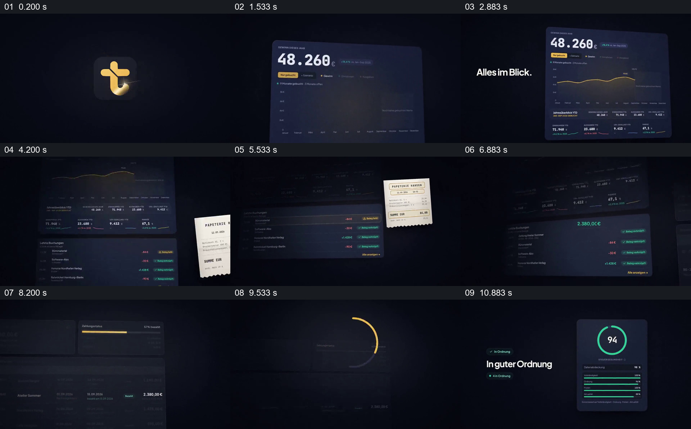

# 从财务总览找到一笔票据，再把明细接到整体状态

- 作品：案例 045《票据、数字与财务界面》（库内索引名）。
- 原片范围：00:00.000–00:12.000，含起点、不含终点；[完整原片](../video.mp4)｜[本卡片段](c01.mp4)，片段起点对应原片 0.000 秒。
- 范围依据：0–12 秒从总览、单据与交易对应延续到付款和综合状态卡，构成一套财务工作空间展示；后续是品牌收尾。
- 观察方式：核看全片 64 帧总览及本卡九宫格；未独立连续原速观看，快速变化和运动节奏待核。未独立听审，声音内容未知。片中事实和演示未独立查证，新题材迁移尚未实测。

## 原画面具体怎样设计

深蓝黑背景中央先建立金色品牌图形，其承载面扩大为略倾斜的深色财务面板。面板顶部显示年度金额 48,260 欧元，黄色折线和下方多项指标逐步显露；旁侧短句 “Alles im Blick.” 留出标题区。

视线随后落到下面的交易列表，原总览仍在上方但变暗。一张浅色纸质收据出现在列表右前方，收据上可辨商户、日期与 84 欧元总额；列表中有对应的 −84 欧元行，以及红绿金额和“凭证已关联”等状态。收据缩小后列表行获得强调，接着另一条收入和付款详情、付款状态横条进入画面。

最后原界面退暗，单独竖卡显示圆形数值 94 与下面若干状态条，左侧短句表示状态良好。数字、凭证与评分均是片中演示，不能据此证明真实交易、自动匹配是否成功或评分的计算依据。

## 为什么这样设计，好在哪里

片段不是只在财务大盘上排列小数字，而是先让人理解它的总览，再把一个具体纸质凭证放到对应的交易行旁：浅色收据与深色列表反差明显，原列表仍可见，有助于理解材料归属。之后付款状态和综合卡把注意力从一笔记录带回更高层的状态。层次切换时保留或压暗已有界面，使不同信息仍像属于同一工作空间，而不是三张无关海报。

必须保留凭证与交易可以核对的关系，以及总览、局部和状态各自的含义；否则只剩“漂亮仪表盘”的外观。圆环、金色线条和倾斜角度可以改变。以上是画面分析，未验证财务数据或观众反应。

## 完整照排指令

以[完整原片](../video.mp4)的 0–12 秒为准。画幅 1280×720，源帧率 60/1。以下拍点为抽帧定位，位置按画幅百分比取近似值。

### 用料

【总览金额】【趋势线】【交易列表】【选中交易】【原票据】【付款状态】【综合读数】来自同一账期，选中行必须能和纸票的日期、金额、类型对应。备【总览短句】【综合短句】【品牌符号】【品牌字】【品牌副句】。真实数字附可核对记录并遮掉非公开字段。

### 按源时刻摆放

1. **0–约 3.600 秒。** 深蓝黑底先在中心显暖金【品牌符号】，随后以偏右的大深蓝矩形接管。卡左上用白粗【总览金额】，下有黄小签；中央低亮细轴与金色【趋势线】逐步浮现，底下补横排小指标。左侧短留白字【总览短句】。窗口略带透视，字不脱离窗面。
2. **约 3.600–7.800 秒。** 总览让位给深色【交易列表】，画中偏左，细灰字分行，状态靠右写绿或红。独立奶白【原票据】斜压在列表右上前层，文字与撕口保留，薄阴影把票和屏幕分开。列表及纸票同场，焦点对到【选中交易】，再推进到该行和【付款状态】。票可静态平移，避免用另一份近似金额票据。窗口建立后至局部推进一直沿用同一列表版本。
3. **约 7.800–10.200 秒。** 将列表压暗，细金弧从中心偏右建立。转为右侧竖深卡，上半青绿圆环包白色【综合读数】，下方几根不同长度细青绿条；左侧小金眉字下放白【综合短句】。指标动态只演一次，落稳后留读。
4. **约 10.200–12.000 秒。** 状态卡退，深底短见白细圆，随后居中显暖金【品牌字】，下方更细【品牌副句】，按 12 秒切出。

### 局部采用

只有对应票据和交易行，可用约 3.600–7.800 秒；若综合指标与总览不能同口径回查，可只采用前两段。

### 验证状态

已对照原片逐秒画序并读回，核对趋势线、暖白票压暗表、付款局部和圆形综合读数。状态字段、精确切帧与换料试摆待核。
